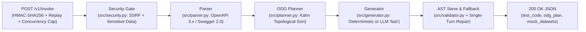

# AutoQA Engine (`auto-qa-engine`)

AutoQA Engine is a FastAPI service (`spec_version: "1.1"`, Python 3.12 container) that turns an OpenAPI 3.0 / 3.1 or Swagger 2.0 specification (JSON or YAML text) into dependency-ordered, syntax-verified Pytest integration tests, synthetic request payloads, and AST-based coverage reports.

**Language:** English | [Türkçe](README.tr.md)

**Table of contents**

- [1. At a glance](#1-at-a-glance)
- [2. What it is, and what it is not](#2-what-it-is-and-what-it-is-not)
- [3. Quick start (two minutes)](#3-quick-start-two-minutes)
- [4. How it works](#4-how-it-works)
- [5. API reference](#5-api-reference)
- [6. Configuration](#6-configuration)
- [7. Use it in CI, in an AI coding tool, or from your own code](#7-use-it-in-ci-in-an-ai-coding-tool-or-from-your-own-code)
- [8. Worked example](#8-worked-example)
- [9. Security model](#9-security-model)
- [10. Limits and operations](#10-limits-and-operations)
- [11. Known limitations](#11-known-limitations)
- [12. Testing and quality](#12-testing-and-quality)
- [13. Project layout](#13-project-layout)
- [14. Troubleshooting and FAQ](#14-troubleshooting-and-faq)
- [15. Versioning and contributing](#15-versioning-and-contributing)
- [16. Authors and contributions](#16-authors-and-contributions)
- [17. Owner TODOs](#17-owner-todos)

---

## 1. At a glance

| Property | Value |
| :--- | :--- |
| **Input** | OpenAPI 3.0 / 3.1 or Swagger 2.0 specification passed inline as a JSON or YAML string (`openapi_spec`), optional target `base_url`, and existing Pytest source (`existing_test_code`) for coverage analysis |
| **Outputs** | Executable Pytest module (`pytest_code` / `test_code` + `test_generated_api.py` artifact), Operation Dependency Graph (`odg_plan`), mock/boundary/security payloads (`mock_datasets`), and coverage metrics |
| **Supported spec features** | OpenAPI 3.0 / 3.1 (`requestBody`, `components/schemas`, `servers`), Swagger 2.0 (`in: body`, `in: formData`, `definitions`, `basePath`), local `#/...` `$ref`, `allOf` merges |
| **Body encodings** | `application/json` (`json=`), `application/x-www-form-urlencoded` (`data=`), `multipart/form-data` (`data=` + `files=` with in-memory `(filename, bytes, content_type)`) |
| **Generated test frameworks** | `pytest-httpx` (default) or `pytest-requests`; running generated tests requires Python >= 3.10, `pytest>=8.0.0`, and `httpx>=0.27.0` or `requests>=2.31.0` |
| **Service runtime** | FastAPI + Uvicorn (`python:3.12-slim`, non-root `USER 1000`, `PORT=8080`, works deterministically without an LLM or with an OpenAI-compatible proxy) |
| **Endpoints** | `GET /health` and HMAC-signed `POST /v1/invoke` (`generate_tests`, `generate_mocks`, `analyze_coverage`) |

---

## 2. What it is, and what it is not

Asking a general-purpose large language model (LLM) to turn a raw OpenAPI specification directly into integration tests often produces uncompilable Python code, hallucinated helper imports, `404 Not Found` errors from calling `GET /users/{id}` before `POST /users`, and weak assertions that only check status codes. AutoQA Engine addresses this with a **Planner-First, AI-Second** pipeline: OpenAPI parsing, dependency ordering via an **Operation Dependency Graph (ODG)**, code generation, and syntax verification are deterministic, while an optional LLM proxy only enriches realistic sample payloads and attempts single-turn syntax repair when enabled.

What it is **not**:

- **Not a replacement for hand-written tests:** It generates structural schema checks, boundary mutations, injection probes, and heuristic ownership assertions from your API contract; domain business rules still require human-written tests.
- **Does not call your API itself:** The container runs with outbound target networking disabled (`network.allow: []`); it returns Python test code in memory for you to run in your own local environment or CI pipeline.
- **Does not fetch URLs:** You must send the OpenAPI spec inline as JSON or YAML text in `openapi_spec`. Passing `spec_url`, `webhook_url`, or similar remote fetch fields is rejected (`422 external_network_disabled` or `ssrf_blocked`).

---

## 3. Quick start (two minutes)

This walkthrough starts the server from a clean virtual environment, sends one HMAC-SHA256 (**Hash-based Message Authentication Code**) signed request, saves the generated test file, and runs it against a local sample API.

### Step 1: Create a virtual environment and install dependencies

The runtime server only needs [requirements.txt](requirements.txt). To also execute the generated Pytest suite or run the repository tests, install [scripts/requirements-dev.txt](scripts/requirements-dev.txt).

On Linux / macOS (`bash`):

```bash
python3 -m venv .venv
source .venv/bin/activate
python -m pip install --upgrade pip
python -m pip install -r requirements.txt -r scripts/requirements-dev.txt
```

On Windows (`PowerShell`):

```powershell
python -m venv .venv
.\.venv\Scripts\Activate.ps1
python -m pip install --upgrade pip
python -m pip install -r requirements.txt -r scripts/requirements-dev.txt
```

> **Note:** If you only need to run the AutoQA Engine HTTP service (for example in production or Docker), `python -m pip install -r requirements.txt` is sufficient. `pytest`, `httpx`, and `requests` are required by the generated test file itself.

### Step 2: Set environment variables and start the server

Setting `PLATFORM_SIGNING_SECRET` is required so `POST /v1/invoke` can verify request signatures. Leave `LLM_BASE_URL` unset or empty to run in deterministic offline mode.

On Linux / macOS (`bash`):

```bash
export PLATFORM_SIGNING_SECRET="local-test-secret"
export LLM_BASE_URL=""
uvicorn src.main:app --host 127.0.0.1 --port 8080
```

On Windows (`PowerShell`):

```powershell
$env:PLATFORM_SIGNING_SECRET = "local-test-secret"
$env:LLM_BASE_URL = ""
uvicorn src.main:app --host 127.0.0.1 --port 8080
```

Verify that the service is healthy in a second terminal:

```bash
curl http://127.0.0.1:8080/health
# Expected output:
# {"status":"ok"}
```

### Step 3: Send a signed request (Python helper)

Run this self-contained script against the running server (or save it as `quick_start.py` and run `python quick_start.py`). It signs the raw JSON body with HMAC-SHA256, calls `generate_tests` for a two-endpoint Items API targeting `http://127.0.0.1:9000`, prints the summary, and writes `test_generated_api.py`:

<!-- runnable -->
```python
import hashlib
import hmac
import json
import os
import time
import urllib.request

SECRET = os.environ.get("PLATFORM_SIGNING_SECRET", "local-test-secret").encode("utf-8")
TINY_SPEC = """
openapi: "3.0.3"
info: {title: Items API, version: "1.0.0"}
paths:
  /items:
    post:
      operationId: create_item
      requestBody:
        required: true
        content:
          application/json:
            schema:
              type: object
              required: [name]
              properties:
                name: {type: string, minLength: 2}
      responses:
        "201": {description: Created}
  /items/{id}:
    get:
      operationId: get_item
      parameters:
        - {name: id, in: path, required: true, schema: {type: string}}
      responses:
        "200": {description: OK}
""".strip()

payload = json.dumps(
    {
        "operation": "generate_tests",
        "input": {
            "openapi_spec": TINY_SPEC,
            "base_url": "http://127.0.0.1:9000",
        },
    }
).encode("utf-8")

ts = str(int(time.time()))
sig = hmac.new(SECRET, ts.encode("utf-8") + b"." + payload, hashlib.sha256).hexdigest()

req = urllib.request.Request(
    "http://127.0.0.1:8080/v1/invoke",
    data=payload,
    method="POST",
    headers={
        "Content-Type": "application/json",
        "X-Platform-Timestamp": ts,
        "X-Platform-Signature": sig,
        "X-Tenant-Id": "demo-tenant",
        "X-Request-Id": "req-quickstart-1",
    },
)

with urllib.request.urlopen(req, timeout=30) as resp:
    result = json.loads(resp.read().decode("utf-8"))

print("HTTP:", resp.status, "status:", result["status"])
print("Summary:", json.dumps(result["output"]["summary"], indent=2))
with open("test_generated_api.py", "w", encoding="utf-8") as fh:
    fh.write(result["output"]["test_code"])
```

#### Shell (`curl` + `openssl`) variant

```bash
export PLATFORM_SIGNING_SECRET="local-test-secret"
cat <<'EOF' > payload.json
{"operation":"generate_tests","input":{"openapi_spec":"openapi: '3.0.3'\ninfo: {title: Items API, version: '1.0.0'}\npaths:\n  /items:\n    post:\n      operationId: create_item\n      requestBody:\n        required: true\n        content:\n          application/json:\n            schema:\n              type: object\n              required: [name]\n              properties:\n                name: {type: string, minLength: 2}\n      responses:\n        '201': {description: Created}\n  /items/{id}:\n    get:\n      operationId: get_item\n      parameters: [{name: id, in: path, required: true, schema: {type: string}}]\n      responses:\n        '200': {description: OK}\n","base_url":"http://127.0.0.1:9000"}}
EOF

TS=$(date +%s)
SIG=$( (printf '%s.' "$TS"; cat payload.json) | openssl dgst -sha256 -hmac "$PLATFORM_SIGNING_SECRET" -hex | awk '{print $NF}' )

curl -sS -X POST "http://127.0.0.1:8080/v1/invoke" \
  -H "Content-Type: application/json" \
  -H "X-Platform-Timestamp: $TS" \
  -H "X-Platform-Signature: $SIG" \
  -H "X-Tenant-Id: demo-tenant" \
  -H "X-Request-Id: req-curl-1" \
  --data-binary "@payload.json"
```

<details>
<summary>Real response excerpt from a clean virtual environment (POST /v1/invoke, deterministic mode)</summary>

```json
{
  "status": "ok",
  "output": {
    "summary": {
      "total_endpoints": 2,
      "total_operations": 2,
      "generated_test_count": 5,
      "positive_tests": 2,
      "negative_boundary_tests": 1,
      "security_injection_tests": 2,
      "ast_valid": true,
      "self_healed": false,
      "estimated_coverage_pct": 100.0
    },
    "odg_plan": [
      {
        "step": 1,
        "operation_id": "create_item",
        "method": "POST",
        "path": "/items",
        "produces": ["item_id"],
        "consumes": []
      },
      {
        "step": 2,
        "operation_id": "get_item",
        "method": "GET",
        "path": "/items/{id}",
        "produces": [],
        "consumes": ["item_id"]
      }
    ]
  }
}
```

</details>

### Step 4: Run the generated test file against a local app

Save this minimal FastAPI target app as `items_app.py`:

```python
from fastapi import FastAPI, HTTPException
from pydantic import BaseModel, Field

class ItemIn(BaseModel):
    name: str = Field(min_length=2)

app = FastAPI()
items: dict[str, dict[str, str]] = {}

@app.post("/items", status_code=201)
def create_item(item: ItemIn):
    items["itm-1"] = {"id": "itm-1", "name": item.name}
    return items["itm-1"]

@app.get("/items/{id}")
def get_item(id: str):
    if id not in items:
        raise HTTPException(404)
    return items[id]
```

Start the target API on port `9000` (matching `"base_url": "http://127.0.0.1:9000"` in Step 3), then execute `pytest test_generated_api.py -v`:

```bash
uvicorn items_app:app --host 127.0.0.1 --port 9000
# In another terminal:
pytest test_generated_api.py -v
```

<details>
<summary>Real pytest output against the local FastAPI target app (5 passed in 0.21s)</summary>

```text
============================= test session starts =============================
collected 5 items

test_generated_api.py::test_step_01_create_item_positive PASSED           [ 20%]
test_generated_api.py::test_step_01_create_item_negative_boundary PASSED  [ 40%]
test_generated_api.py::test_step_01_create_item_security_injection PASSED [ 60%]
test_generated_api.py::test_step_02_get_item_positive PASSED              [ 80%]
test_generated_api.py::test_step_02_get_item_security_unknown_id_and_auth PASSED [100%]

============================== 5 passed in 0.21s ==============================
```

</details>

---

## 4. How it works



| Module | Path | Mode | Responsibility |
| :--- | :--- | :--- | :--- |
| Request gateway | [`src/main.py`](src/main.py) | Deterministic | FastAPI routing (`GET /health`, `POST /v1/invoke`), bounded concurrency (`asyncio.Semaphore(2)` + 2-worker executor), surrogate/encoding checks, error envelope formatting |
| Security & contract layer | [`src/security.py`](src/security.py) | Deterministic | Constant-time HMAC-SHA256 verification (`300s` replay window), **SSRF (Server-Side Request Forgery)** IP/hostname validator, payment-card (**IIN** + Luhn), CVV/expiry, and **TCKN** checksum scanners |
| OpenAPI parser | [`src/parser.py`](src/parser.py) | Deterministic | `yaml.SafeLoader` custom alias tracker, node/depth/budget caps, OpenAPI 3.0 / 3.1 + Swagger 2.0 normalization, local `#/...` `$ref` and `allOf` resolution, base path extraction |
| ODG planner | [`src/planner.py`](src/planner.py) | Deterministic | Resource ID producer/consumer inference, child-before-parent `DELETE` constraints, Kahn topological sort with method priority tie-breaking |
| Pipeline & data synthesizer | [`src/generator.py`](src/generator.py) | Deterministic + optional LLM | Schema-aware positive/boundary/injection mocks, optional OpenAI-compatible `model="fast"` enrichment (`jsonschema` validated), single-turn LLM syntax repair, AST-based coverage analyzer |
| Code builder & AST sieve | [`src/validator.py`](src/validator.py) | Deterministic | **AST (Abstract Syntax Tree)** parsing and forbidden call/import sieve (`eval`, `exec`, `open`, `subprocess`, `socket`), Pytest template emission (`pytest-httpx` / `pytest-requests`) |

### Key pipeline behaviours

- **Operation Dependency Graph (ODG) ordering:** [`src/planner.py`](src/planner.py) inspects paths, request bodies, and response schemas to infer produced IDs (for example `POST /users` produces `user_id`) and consumed path/body parameters (for example `GET /users/{id}` consumes `user_id`). It schedules operations with Kahn's topological sort using priority `POST -> GET -> PUT -> PATCH -> DELETE`, adding explicit dependency edges so child `DELETE` endpoints (such as `/users/{user_id}/orders/{id}`) run before parent `DELETE` endpoints (`/users/{id}`).
- **`ODG_STATE` capture and producer-failure skips:** Each generated positive `POST` step adds its produced variable names to `ATTEMPTED_PRODUCERS`, executes the request, and stores the created ID from common JSON keys (`id`, `uuid`, `<resource>_id`, etc.) into the module-level `ODG_STATE` dictionary. Downstream steps that consume those variables check `ATTEMPTED_PRODUCERS` vs. `ODG_STATE`; if the producer failed to capture a required ID, the dependent test calls `pytest.skip("Producer step did not capture: ...")` instead of failing noisily with stale placeholder IDs.
- **Unknown-ID and invalid-auth probes (`*_security_unknown_id_and_auth`):** For operations with bound path parameters or declared OpenAPI `security` requirements (when no body injection test was already emitted for that step), the generator adds a security probe substituting `nonexistent-unauthorized-id-999999` and sending `Authorization: Bearer invalid-token`, asserting status `(400, 401, 403, 404, 422)`.
- **Heuristic ownership assertions (BOLA checks):** When an operation binds path parameters (such as `user_id`), positive tests inspect returned JSON dicts and assert `str(data[key]) == str(ODG_STATE.get(state_key, ...))` whenever keys matching the path parameter name, `state_key`, `user_id`, `userId`, or `owner_id` appear in the response object (even if the OpenAPI spec omitted a response schema). This catches basic **BOLA (Broken Object Level Authorization)** cross-user leaks using those common key names, though custom or deeply nested ownership fields are outside this heuristic.
- **Form and multipart encoding:** [`src/validator.py`](src/validator.py) selects request kwargs by media type: `json=` for JSON, `data=` for `application/x-www-form-urlencoded` (booleans encoded as `"true"`/`"false"`, `None` as `""`, nested objects JSON-serialized), and both `data=` and `files=` for `multipart/form-data` where fields of `type: file` or `format: binary`/`byte` send an in-memory tuple `("sample.txt", b"sample", "text/plain")` without touching disk.
- **Base path handling rules:** [`src/generator.py`](src/generator.py) extracts any non-templated base path from Swagger 2.0 `basePath` or OpenAPI 3 `servers[0].url`:
  - If `input.base_url` is omitted, the spec's server URL (if HTTP/HTTPS) or `http://localhost:8000` is used.
  - If `input.base_url` has no path (or only `/`), e.g. `http://127.0.0.1:8080`, the spec's base path (e.g. `/v2`) is appended automatically (`http://127.0.0.1:8080/v2`).
  - If `input.base_url` already ends with that base path or already contains a different non-root path, it is preserved without duplication.
- **Single-turn LLM repair and deterministic fallback:** Every generated Pytest file goes through `validate_and_count_assertions` (`ast.parse()` plus AST walk rejecting `eval`, `exec`, `compile`, `__import__`, `system`, `popen`, `open`, and imports of `subprocess`, `pty`, `shutil`, `socket`). If validation fails and the LLM client is enabled, `attempt_single_turn_ast_repair` runs one `temperature=0.0` chat completion on `model="fast"`. If repair fails or the LLM client is disabled, the engine regenerates the suite using strictly deterministic positive-only templates (`include_negative_tests=False`, `include_security_tests=False`) and sets `summary.self_healed = true`.

---

## 5. API reference

### 5.1 Endpoints and required headers

| Endpoint | Method | Auth | Purpose |
| :--- | :--- | :--- | :--- |
| `/health` | `GET` | None | Liveness probe; returns `200 OK` with `{"status": "ok"}` off the worker pool (`< 2s` budget) |
| `/v1/invoke` | `POST` | HMAC-SHA256 | Executes `generate_tests`, `generate_mocks`, or `analyze_coverage` on an inline OpenAPI spec |

**Headers for `POST /v1/invoke`:**

| Header | Required | Description |
| :--- | :--- | :--- |
| `Content-Type` | Yes | `application/json` |
| `X-Platform-Timestamp` | Yes | ASCII integer Unix epoch timestamp in seconds |
| `X-Platform-Signature` | Yes | Lowercase hex HMAC-SHA256 digest of `timestamp + "." + raw_body_bytes` |
| `X-Tenant-Id` | Recommended | Tenant identifier logged with `request_id` (defaults to `"unknown"`) |
| `X-Request-Id` | Recommended | Request correlation ID echoed in structured server logs (defaults to `"unknown"`) |

### 5.2 Signing algorithm and 300-second replay window

Before JSON parsing begins, `verify_signature` in [`src/security.py`](src/security.py) verifies:

1. Both `X-Platform-Timestamp` and `X-Platform-Signature` are present and ASCII-encodable.
2. `X-Platform-Timestamp` parses as an integer and `abs(time.time() - int(ts)) <= 300`.
3. `expected = hmac.new(PLATFORM_SIGNING_SECRET.encode("utf-8"), ts.encode("utf-8") + b"." + raw_body_bytes, hashlib.sha256).hexdigest()`.
4. `hmac.compare_digest(expected, sig.strip().lower())` evaluates `True` in constant time.

#### Python example

```python
import hashlib, hmac, json, os, time, urllib.request

secret = os.environ["PLATFORM_SIGNING_SECRET"].encode("utf-8")
raw_body = json.dumps({"operation": "generate_mocks", "input": {"openapi_spec": "..."}}).encode("utf-8")
ts = str(int(time.time()))
sig = hmac.new(secret, ts.encode("utf-8") + b"." + raw_body, hashlib.sha256).hexdigest()

req = urllib.request.Request(
    "http://127.0.0.1:8080/v1/invoke",
    data=raw_body,
    method="POST",
    headers={
        "Content-Type": "application/json",
        "X-Platform-Timestamp": ts,
        "X-Platform-Signature": sig,
        "X-Tenant-Id": "demo-tenant",
        "X-Request-Id": "req-py-1",
    },
)
with urllib.request.urlopen(req, timeout=30) as resp:
    print(resp.status, resp.read().decode("utf-8"))
```

#### Node.js example

```javascript
const crypto = require("node:crypto");

const secret = process.env.PLATFORM_SIGNING_SECRET || "local-test-secret";
const payload = JSON.stringify({
  operation: "generate_tests",
  input: { openapi_spec: "openapi: '3.0.3'\ninfo: {title: Demo, version: '1'}\npaths:\n  /ping:\n    get:\n      responses:\n        '200': {description: OK}\n" },
});
const ts = Math.floor(Date.now() / 1000).toString();
const sig = crypto.createHmac("sha256", secret).update(`${ts}.${payload}`).digest("hex");

fetch("http://127.0.0.1:8080/v1/invoke", {
  method: "POST",
  headers: {
    "Content-Type": "application/json",
    "X-Platform-Timestamp": ts,
    "X-Platform-Signature": sig,
    "X-Tenant-Id": "demo-tenant",
    "X-Request-Id": "req-node-1",
  },
  body: payload,
})
  .then((r) => r.json())
  .then((data) => console.log(data.status, data.output.summary));
```

#### Shell (`curl` + `openssl`) example

```bash
TS=$(date +%s)
SIG=$( (printf '%s.' "$TS"; cat payload.json) | openssl dgst -sha256 -hmac "$PLATFORM_SIGNING_SECRET" -hex | awk '{print $NF}' )
curl -sS -X POST "http://127.0.0.1:8080/v1/invoke" \
  -H "Content-Type: application/json" \
  -H "X-Platform-Timestamp: $TS" \
  -H "X-Platform-Signature: $SIG" \
  -H "X-Tenant-Id: demo-tenant" \
  -H "X-Request-Id: req-sh-1" \
  --data-binary "@payload.json"
```

### 5.3 Request and response envelope

**Request body:**

```json
{
  "operation": "generate_tests | generate_mocks | analyze_coverage",
  "input": {},
  "config": {}
}
```

**Success response (`HTTP 200`):**

```json
{
  "output": {},
  "status": "ok | fail | needs_review",
  "artifacts": [],
  "actions": []
}
```

**When each `status` value is returned:**

| `status` | Returned by | Condition |
| :--- | :--- | :--- |
| `"ok"` | All three operations | `generate_tests`: `summary.ast_valid == true` and (`not config.fail_on_missing_auth` or every targeted operation declares OpenAPI `security`). `generate_mocks`: always `"ok"`. `analyze_coverage`: `coverage_pct >= min_coverage_pct` (or `min_threshold <= 0` / no uncovered ops) and auth check passes. |
| `"fail"` | `analyze_coverage` | `coverage_pct < min_coverage_pct` (including when `existing_test_code` is empty and `min_coverage_pct > 0` with uncovered operations). Designed to fail CI gates when `fail-on: fail` is configured. |
| `"needs_review"` | `generate_tests`, `analyze_coverage` | Returned if `ast_valid` is `false`, or when `config.fail_on_missing_auth` is `true` and at least one operation lacks an OpenAPI `security` requirement (while `analyze_coverage` would otherwise be `"ok"`). |

**Error response (`HTTP 4xx / 5xx`):**

```json
{
  "error": {
    "code": "snake_case_error_code",
    "message": "Human-readable description"
  }
}
```

### 5.4 Operations

#### `generate_tests`

Parses an OpenAPI/Swagger specification, computes the ODG execution order, synthesizes payloads, and returns executable, AST-validated Pytest code (`timeout_s: 60` in [`agent.yaml`](agent.yaml)).

**Input fields:**

| Field | Type | Required | Default | Constraints & notes |
| :--- | :--- | :--- | :--- | :--- |
| `openapi_spec` | `string` | Yes | — | `minLength: 10`; raw JSON or YAML OpenAPI 3.x / Swagger 2.0 text (or mapping accepted internally) |
| `base_url` | `string` | No | `"http://localhost:8000"` | Target API base URL interpolated into `BASE_URL` in generated test code (falls back to spec `servers[0].url` if omitted) |
| `include_negative_tests` | `boolean` | No | `true` | Emit `_negative_boundary` (`400`/`422`) tests for write operations (`POST`, `PUT`, `PATCH`) |
| `include_security_tests` | `boolean` | No | `true` | Emit `_security_injection` (SQLi/XSS) and `_security_unknown_id_and_auth` probes |
| `target_endpoints` | `array[string]` | No | `null` (all) | Filter operations to matching OpenAPI paths (or method+path patterns); all strings required |

**Output fields (`output`) and artifacts:**

- `summary`: `total_endpoints` (int), `total_operations` (int), `generated_test_count` (int), `positive_tests` (int), `negative_boundary_tests` (int), `security_injection_tests` (int), `ast_valid` (bool), `self_healed` (bool), `estimated_coverage_pct` (number; computed relative to total operations in the full spec before `target_endpoints` filtering)
- `odg_plan`: ordered array of `{step, operation_id, method, path, produces, consumes}`
- `pytest_code` / `test_code` (equivalent strings): full Pytest module text
- `mock_datasets` / `mock_data`: per-`operation_id` mapping of positive, boundary, and security payloads
- `endpoints_covered`: list of covered paths
- `total_assertions`: integer count of `assert` statements in the AST
- `artifacts`: `[{"name": "test_generated_api.py", "mime_type": "text/x-python", "content": "<test_code>"}]`

Minimal request/response pair: see [Step 3](#step-3-send-a-signed-request-python-helper) above.

#### `generate_mocks`

Generates schema-constrained positive, boundary, and injection payloads without generating Pytest files (`timeout_s: 30` in [`agent.yaml`](agent.yaml), `artifacts: []`).

**Input fields:**

| Field | Type | Required | Default | Constraints & notes |
| :--- | :--- | :--- | :--- | :--- |
| `openapi_spec` | `string` | Yes | — | `minLength: 10`; JSON or YAML OpenAPI 3.x / Swagger 2.0 text |
| `count` | `integer` | No | `3` | Number of valid sample variants per operation (`valid_samples`), defined with schema `maximum: 20` |

**Output fields (`output`):**

- `total_operations` (`integer`)
- `mock_datasets` (`object` keyed by `operation_id`, containing `valid_payload`, `valid_samples`, `boundary_payloads`, `security_payloads`)

<details>
<summary>Real generate_mocks request and response from a clean virtual environment</summary>

Request:

```json
{
  "operation": "generate_mocks",
  "input": {
    "openapi_spec": "openapi: '3.0.3'\ninfo: {title: Items API, version: '1.0.0'}\npaths:\n  /items:\n    post:\n      operationId: create_item\n      requestBody:\n        required: true\n        content:\n          application/json:\n            schema:\n              type: object\n              required: [name]\n              properties:\n                name: {type: string, minLength: 2}\n      responses:\n        '201': {description: Created}",
    "count": 2
  }
}
```

Response:

```json
{
  "output": {
    "total_operations": 1,
    "mock_datasets": {
      "create_item": {
        "valid_payload": {
          "name": "Ayşe Yılmaz"
        },
        "valid_samples": [
          {
            "name": "Ayşe Yılmaz"
          },
          {
            "name": "Ayşe Yılmaz 2"
          }
        ],
        "boundary_payloads": [
          {},
          {
            "name": ""
          }
        ],
        "security_payloads": [
          {
            "name": "'; DROP TABLE users; -- <script>alert(1)</script>"
          }
        ]
      }
    }
  },
  "status": "ok",
  "artifacts": [],
  "actions": []
}
```

</details>

#### `analyze_coverage`

Parses an OpenAPI spec and an optional Pytest source string using Python AST call extraction, reports matched vs. missing operations, and evaluates against `config.min_coverage_pct` (`timeout_s: 30` in [`agent.yaml`](agent.yaml), `artifacts: []`).

**Input fields:**

| Field | Type | Required | Default | Constraints & notes |
| :--- | :--- | :--- | :--- | :--- |
| `openapi_spec` | `string` | Yes | — | `minLength: 10`; JSON or YAML OpenAPI 3.x / Swagger 2.0 text |
| `existing_test_code` | `string` | No | `""` | Existing Python/Pytest file contents; max `200,000` UTF-8 bytes and max `80` AST depth |

**Output fields (`output`):**

- `coverage_pct` (`number`), `total_operations` (`integer`), `covered_operations` (`array[string]`), `uncovered_operations` (`array[string]`), `recommendations` (`array[string]`)

<details>
<summary>Real analyze_coverage request and response from a clean virtual environment</summary>

Request:

```json
{
  "operation": "analyze_coverage",
  "config": {
    "min_coverage_pct": 80
  },
  "input": {
    "openapi_spec": "openapi: '3.0.3'\ninfo: {title: Items API, version: '1.0.0'}\npaths:\n  /items:\n    post:\n      operationId: create_item\n      responses:\n        '201': {description: Created}\n  /items/{id}:\n    get:\n      operationId: get_item\n      parameters: [{name: id, in: path, required: true, schema: {type: string}}]\n      responses:\n        '200': {description: OK}",
    "existing_test_code": "def test_create_item(client):\n    r = client.post('/items', json={'name': 'Kalem'})\n    assert r.status_code == 201\n"
  }
}
```

Response (`status: "fail"` because `50.0 < 80`):

```json
{
  "output": {
    "coverage_pct": 50.0,
    "total_operations": 2,
    "covered_operations": [
      "create_item"
    ],
    "uncovered_operations": [
      "get_item"
    ],
    "recommendations": [
      "GET /items/{id} (get_item) için pozitif ve sınır değer (400/422) testleri eksik."
    ]
  },
  "status": "fail",
  "artifacts": [],
  "actions": []
}
```

</details>

### 5.5 Error reference

Every error emitted by `src/` uses the envelope `{"error": {"code": "...", "message": "..."}}`. Never rely on exact human text in `message`; match on HTTP status and `error.code`.

| HTTP Status | `error.code` | When it happens | How to fix it |
| :--- | :--- | :--- | :--- |
| `400` | `bad_request` | Framework-level `HTTPException(400)` | Verify HTTP request syntax and headers |
| `401` | `invalid_timestamp` | `X-Platform-Timestamp` is missing, non-ASCII, non-integer, or `abs(now - ts) > 300` | Synchronize clock with NTP and sign with current integer epoch seconds |
| `401` | `invalid_signature` | `X-Platform-Signature` is missing, non-ASCII, or does not match `HMAC-SHA256(secret, ts + "." + raw_bytes)` | Sign the exact transmitted UTF-8 bytes with matching `PLATFORM_SIGNING_SECRET` |
| `401` | `unauthorized` | Generic `401` without `"timestamp"` or `"signature"` context | Provide valid HMAC headers |
| `404` | `not_found` | Request path does not match `/health` or `/v1/invoke` | Send invoke requests to `POST /v1/invoke` and probes to `GET /health` |
| `405` | `method_not_allowed` | Wrong HTTP method (e.g. `GET /v1/invoke` or `POST /health`) | Use `GET` for `/health` and `POST` for `/v1/invoke` |
| `4xx / 5xx` | `http_<status_code>` | Fallback in [`src/main.py`](src/main.py) for any other framework `StarletteHTTPException` (e.g. `http_415`) | Inspect HTTP status code and request framing |
| `422` | `validation_error` | FastAPI `RequestValidationError`, `HTTPException(422)`, or a raised `ValueError` whose prefix does not match `^[a-z][a-z0-9_]{1,63}$` | Check JSON field types and value constraints |
| `422` | `invalid_json` | Request body is empty, non-JSON, or parses to a non-object (array/scalar) | Send a valid UTF-8 JSON object `{"operation": ..., "input": ...}` |
| `422` | `invalid_encoding` | Request JSON or YAML contains lone UTF-16 surrogates (e.g. `\ud800`) or triggers a `UnicodeError` during encoding | Ensure strings contain valid UTF-8 scalar values with no lone surrogates |
| `422` | `unknown_operation` | `operation` is missing, non-string, or not one of `generate_tests`, `generate_mocks`, `analyze_coverage` | Set `operation` to one of the three supported operation names |
| `422` | `prohibited_sensitive_data` | Input, config, spec (even after Unicode escape decoding), or `existing_test_code` contains PAN (card IIN + Luhn), CVV/expiry/bank secret keys, or a valid 11-digit TCKN | Remove real/Luhn-valid payment numbers, CVV/expiry pairs, and valid TCKNs; use clearly fake sample strings |
| `422` | `ssrf_blocked` | `base_url` (or `spec_url` / `webhook_url` / etc.) uses blocked hosts (`169.254.169.254`, `metadata.google.internal`, `0.0.0.0`, `.internal`, RFC 1918 in user `base_url`), or unsafe schemes (`file://`, `ftp://`, `gopher://`) | Use public HTTPS URLs or `http(s)://localhost` / `127.0.0.1` / `::1` for local `base_url` targets |
| `422` | `external_network_disabled` | Request supplied a non-empty `spec_url`, `katalog_url`, `webhook_url`, `callback_url`, or `target_url` | Remove remote URL fields and send spec text directly in `input.openapi_spec` |
| `422` | `empty_openapi_spec` | `openapi_spec` is an empty/whitespace-only string (when present) | Pass a non-empty JSON or YAML OpenAPI spec |
| `422` | `invalid_openapi_syntax` | JSON/YAML parsing failure (`yaml.YAMLError` / `json.JSONDecodeError`) or cyclic YAML alias (`&a ... *a` cycle) | Validate spec YAML/JSON syntax and remove recursive YAML aliases |
| `422` | `spec_too_large` | Spec exceeds `MAX_SCHEMA_DEPTH * 2` (`80`), `MAX_ALIAS_EXPANDED_NODES` (`120,000`), `MAX_SPEC_TOTAL_NODES` (`150,000`), or `$ref` expansion `MAX_REF_EXPANSION_NODES` (`120,000`) | Split large APIs into smaller per-service specs or reduce repeated alias/$ref expansion fan-out |
| `422` | `invalid_openapi_type` | `openapi_spec` is neither a string nor a dict (for instance a list or integer) | Pass `openapi_spec` as a YAML or JSON string |
| `422` | `invalid_openapi_root` | Parsed JSON/YAML top level is not a mapping/object | Ensure the spec root has top-level keys (`openapi`/`swagger`, `info`, `paths`) |
| `422` | `missing_paths` | `paths` key is missing, not a mapping, or empty `{}` | Add at least one endpoint under `paths` |
| `422` | `no_operations_found` | `paths` exists, or `target_endpoints` filters everything out, leaving zero HTTP operations | Add valid HTTP method definitions (`get`, `post`, `put`, `patch`, `delete`, `options`, `head`) or widen `target_endpoints` |
| `422` | `missing_openapi_spec` | `input.openapi_spec` is omitted or invalid/empty at operation entry | Include `input.openapi_spec` in the request payload |
| `422` | `invalid_target_endpoints` | `target_endpoints` is not a list or contains non-string elements | Pass a JSON array of endpoint path strings or omit `target_endpoints` |
| `422` | `invalid_count` | `generate_mocks` received non-integer or boolean `count` | Pass an integer between `1` and `20` (default `3`) |
| `422` | `invalid_existing_test_code` | `existing_test_code` is not a string, exceeds `200,000` UTF-8 bytes, or exceeds `MAX_AST_DEPTH` (`80`) | Keep analyzed test files under `200 KB` and within standard nesting depth |
| `422` | `invalid_min_coverage_pct` | `config.min_coverage_pct` is boolean or non-numeric | Pass a number/integer between `0` and `100` (default `80`) |
| `422` | `invalid_input_shape` | Internal `InputShapeError` wrapping unexpected `TypeError`, `KeyError`, `AttributeError`, `IndexError`, or `RecursionError` on malformed input structures without leaking tracebacks | Check OpenAPI schema types (for instance `properties`, `parameters`, `responses` structures) |
| `429` | `server_busy` | More than `MAX_CONCURRENT_INVOKES` (`2`) heavy `/v1/invoke` tasks are already running after waiting `0.05s`; returned with header `Retry-After: 2` | Retry with exponential backoff respecting `Retry-After` |
| `500` | `processing_failed` | Unhandled server exception outside input-shape guards (logs `tenant_id`, `request_id`, exception class) | Check server stdout logs using `X-Request-Id` |

---

## 6. Configuration

### Environment variables

Every environment variable read directly by `src/` (plus `PORT` in [`Dockerfile`](Dockerfile)):

| Variable | Read in | Default | Behaviour when unset / empty | Secret? |
| :--- | :--- | :--- | :--- | :--- |
| `PLATFORM_SIGNING_SECRET` | [`src/security.py`](src/security.py), [`src/generator.py`](src/generator.py) | `""` (none) | **Required for `/v1/invoke`:** raises `RuntimeError` if empty when signing or verifying requests | **Yes** |
| `LLM_BASE_URL` | [`src/generator.py`](src/generator.py) | `""` | Disables the LLM client; engine runs in deterministic mode | No |
| `LLM_API_KEY` | [`src/generator.py`](src/generator.py) | `""` | Both `LLM_BASE_URL` and `LLM_API_KEY` must be non-empty to enable LLM calls; otherwise deterministic mode runs | **Yes** |
| `LLM_TIMEOUT_S` | [`src/generator.py`](src/generator.py) | `12.0` | Uses `12.0` seconds (invalid floats also fall back to `12.0`); parsed floats are clamped to `[0.1, 45.0]` seconds | No |
| `PORT` | [`Dockerfile`](Dockerfile) | `8080` | Container binds `uvicorn` to port `8080` | No |

### Per-request `config` options

Defined in [`agent.yaml`](agent.yaml) (`config_schema`):

| Field | Type | Values / Range | Default | Effect |
| :--- | :--- | :--- | :--- | :--- |
| `test_framework` | `string` | `pytest-httpx`, `pytest-requests` | `pytest-httpx` | Controls whether generated Pytest suites import `httpx.Client` or `requests.Session` |
| `default_locale` | `string` | `tr-TR`, `en-US` | `tr-TR` | Selects localized deterministic mock strings (names, emails, cities, sample words) and LLM localization prompt hints |
| `min_coverage_pct` | `integer` | `0`–`100` | `80` | Coverage threshold in `analyze_coverage`; below this threshold returns `status: "fail"` |
| `fail_on_missing_auth` | `boolean` | `true`, `false` | `false` | When `true`, forces `status: "needs_review"` if any targeted operation has no OpenAPI `security` scheme (`generate_tests` / `analyze_coverage`), and adds security warnings for `GET` endpoints too |

### Deterministic mode vs. LLM-enriched mode

- **Deterministic mode (`LLM_BASE_URL=""` or `LLM_API_KEY=""`):** Zero outbound HTTP calls. All mocks, boundary cases, security injections, and Pytest templates are generated purely from OpenAPI/Swagger schemas and deterministic generators.
- **LLM-enriched mode (both `LLM_BASE_URL` and `LLM_API_KEY` set):** Calls the configured OpenAI-compatible proxy using `model="fast"` with `max_retries=0` and `timeout=LLM_TIMEOUT_S`.
  - Returned mock payloads are schema-checked with `jsonschema.validate()` against the operation schema; invalid or out-of-schema enrichments are discarded.
  - Outputs containing leaked system prompts, env secrets (`PLATFORM_SIGNING_SECRET`, `LLM_API_KEY`), or prohibited payment/TCKN data are rejected by `_contains_leaked_prompt_or_secrets()`.
  - On timeout, HTTP error, or rejected output, the engine falls back silently to deterministic mocks and logs `llm_enrichment=fallback_timeout` or `llm_enrichment=fallback_rejected` with `tenant_id` and `request_id`.

---

## 7. Use it in CI, in an AI coding tool, or from your own code

Full integration templates and verification notes live in [`integrations/common.md`](integrations/common.md), [`integrations/claude-code.md`](integrations/claude-code.md), [`integrations/codex.md`](integrations/codex.md), and [`integrations/cursor.mdc`](integrations/cursor.mdc). Never commit secrets or literal tokens: pass credentials solely through `PLATFORM_SECRET_KEY` (empty `PLATFORM_SECRET_KEY=` inside gitignored `.env`, or GitHub Actions `${{ secrets.PLATFORM_SECRET_KEY }}`).

### CI (GitHub Actions: `.github/workflows/auto-qa.yml`)

```yaml
name: AutoQA Contract & Coverage Gate
on: [push, pull_request]

jobs:
  auto-qa:
    runs-on: ubuntu-latest
    steps:
      - uses: actions/checkout@v4
      - name: Check API coverage and generate tests
        uses: platform-tld/agent-action@v1
        with:
          agent: auto-qa-engine
          operation: analyze_coverage
          fail-on: fail
        env:
          PLATFORM_SECRET_KEY: ${{ secrets.PLATFORM_SECRET_KEY }}
```

*(Note: `platform-tld/agent-action@v1` above illustrates the platform CI integration documented in `integrations/`; when self-hosting directly without the marketplace gateway, invoke your deployed `POST /v1/invoke` endpoint with HMAC signing in CI instead.)*

### MCP (AI coding tools)

For Claude Code / Cursor MCP setups documented in [`integrations/claude-code.md`](integrations/claude-code.md):

```bash
claude mcp add --transport http auto-qa-engine https://mcp.platform.tld/auto-qa-engine \
  --header "Authorization: Bearer $PLATFORM_SECRET_KEY"
```

### Direct REST / local script usage

From your own backend or CI script (or via a self-hosted instance using the Quick Start signing helper): read `PLATFORM_SIGNING_SECRET` / `PLATFORM_SECRET_KEY` from environment variables, send `openapi_spec` inline, check `result["status"] != "fail"` and `result["output"]["summary"]["ast_valid"] is True`, and write `result["output"]["test_code"]` (or `artifacts[0]["content"]`) to `tests/integration/test_generated_api.py`.

---

## 8. Worked example

This walkthrough uses the black-box shop API specification [`independent_tests/spec_shop.yaml`](independent_tests/spec_shop.yaml) (5 paths, 6 operations including a nested route `/users/{user_id}/orders/{order_id}`) and runs the single generated test file against four reference servers in [`independent_tests/servers.py`](independent_tests/servers.py):

- `good_app`: compliant reference server
- `bola_app`: returns `user_id="SOMEONE_ELSE"` on `GET /users/{user_id}/orders/{order_id}`
- `type_app`: omits required field `email` in `POST /users` responses
- `down_app`: returns HTTP `500` on `POST /users`

### 1. Generate tests against the shop spec

Run the Quick Start signing helper with `independent_tests/spec_shop.yaml` and target `base_url` set to the running reference server port (below, `pytest` runs from a clean virtual environment against live `uvicorn independent_tests.servers:<variant>` servers).

#### Generated ODG execution plan (`output.odg_plan`)

```json
[
  {"step": 1, "operation_id": "create_user",    "method": "POST",   "path": "/users",                              "produces": ["user_id"],             "consumes": []},
  {"step": 2, "operation_id": "create_order",   "method": "POST",   "path": "/orders",                             "produces": ["order_id", "user_id"], "consumes": ["user_id"]},
  {"step": 3, "operation_id": "get_user",       "method": "GET",    "path": "/users/{id}",                         "produces": [],                      "consumes": ["user_id"]},
  {"step": 4, "operation_id": "get_order",      "method": "GET",    "path": "/orders/{id}",                        "produces": [],                      "consumes": ["order_id"]},
  {"step": 5, "operation_id": "get_user_order", "method": "GET",    "path": "/users/{user_id}/orders/{order_id}",  "produces": [],                      "consumes": ["user_id", "order_id"]},
  {"step": 6, "operation_id": "delete_user",    "method": "DELETE", "path": "/users/{id}",                         "produces": [],                      "consumes": ["user_id"]}
]
```

Summary returned: `total_endpoints: 5`, `total_operations: 6`, `generated_test_count: 14` (`6` positive, `2` boundary, `6` security), `ast_valid: true`, `self_healed: false`.

<details>
<summary>Excerpt of the generated test_shop.py file (ODG_STATE wiring and step 1 + step 5)</summary>

```python
ODG_STATE: dict[str, object] = {}
ATTEMPTED_PRODUCERS: set[str] = set()

def test_step_01_create_user_positive(api_client):
    # "Step 1: POST /users (Produces: ['user_id'], Consumes: [])"
    ATTEMPTED_PRODUCERS.update(['user_id'])
    url = _format_url('/users', {})
    payload = {'name': 'Ayşe Yılmaz', 'email': 'ayse.yilmaz@ornek.com'}
    ...
    response = api_client.post(url, json=payload)
    assert response.status_code in [201]
    ...
    captured_id = next((data[k] for k in ('id', 'uuid', 'user_id') if k in data and data[k] is not None), None)
    if captured_id is not None:
        ODG_STATE['user_id'] = captured_id
    assert 'id' in data and isinstance(data['id'], str)
    assert 'name' in data and isinstance(data['name'], str)
    assert 'email' in data and isinstance(data['email'], str)

def test_step_05_get_user_order_positive(api_client):
    # "Step 5: GET /users/{user_id}/orders/{order_id} (Produces: [], Consumes: ['user_id', 'order_id'])"
    missing = [k for k in ['user_id', 'order_id'] if k in ATTEMPTED_PRODUCERS and k not in ODG_STATE]
    if missing:
        pytest.skip("Producer step did not capture: " + ", ".join(missing))
    url = _format_url('/users/{user_id}/orders/{order_id}', {'user_id': 'user_id', 'order_id': 'order_id'})
    response = api_client.get(url)
    assert response.status_code in [200]
    ...
    assert str(data['user_id']) == str(ODG_STATE.get('user_id', 'test-user_id-1'))
```

</details>

### 2. Commands and real test results across all 4 server variants

```bash
# Terminal 1: start any reference server from independent_tests/servers.py
python -m uvicorn independent_tests.servers:good_app --host 127.0.0.1 --port 9001
# Terminal 2: generate test_generated_api.py with base_url=http://127.0.0.1:9001, then run:
python -m pytest test_generated_api.py -v -rfs --no-header
```

| Server variant | Result | Real failure / skip observed |
| :--- | :--- | :--- |
| `good_app` | `14 passed in 0.22s` | All ODG producer/consumer, negative, and security tests pass |
| `bola_app` | `1 failed, 13 passed in 0.30s` | `test_step_05_get_user_order_positive` failed: `AssertionError: assert 'SOMEONE_ELSE' == '<captured user_id>'` |
| `type_app` | `1 failed, 13 passed in 0.28s` | `test_step_01_create_user_positive` failed: `AssertionError: assert 'email' in {'id': '...', 'name': 'Ayşe Yılmaz'}` |
| `down_app` | `1 failed, 6 passed, 7 skipped in 0.29s` | `test_step_01_create_user_positive` failed (`assert 500 in [201]`); 7 consumer steps skipped (`Producer step did not capture: user_id` / `order_id`) |

<details>
<summary>Raw pytest outputs for good_app, bola_app, type_app, and down_app</summary>

```text
=== good_app ===
============================= 14 passed in 0.22s ==============================

=== bola_app ===
FAILED test_shop_bola_app.py::test_step_05_get_user_order_positive
> assert str(data['user_id']) == str(ODG_STATE.get('user_id', 'test-user_id-1'))
E AssertionError: assert 'SOMEONE_ELSE' == '93ac312d-5a90-482c-8961-591648b395a9'
======================== 1 failed, 13 passed in 0.30s =========================

=== type_app ===
FAILED test_shop_type_app.py::test_step_01_create_user_positive
> assert 'email' in data
E AssertionError: assert 'email' in {'id': '57391b1c-b87c-4e18-a729-486b0373dc54', 'name': 'Ayşe Yılmaz'}
======================== 1 failed, 13 passed in 0.28s =========================

=== down_app ===
FAILED test_shop_down_app.py::test_step_01_create_user_positive (assert 500 in [201])
SKIPPED [1] test_step_02_create_order_positive: Producer step did not capture: user_id
SKIPPED [1] test_step_02_create_order_negative_boundary: Producer step did not capture: user_id
SKIPPED [1] test_step_02_create_order_security_injection: Producer step did not capture: user_id
SKIPPED [1] test_step_03_get_user_positive: Producer step did not capture: user_id
SKIPPED [1] test_step_04_get_order_positive: Producer step did not capture: order_id
SKIPPED [1] test_step_05_get_user_order_positive: Producer step did not capture: user_id, order_id
SKIPPED [1] test_step_06_delete_user_positive: Producer step did not capture: user_id
=================== 1 failed, 6 passed, 7 skipped in 0.29s ===================
```

</details>

---

## 9. Security model

- **Timing-safe HMAC and replay protection:** `POST /v1/invoke` verifies `X-Platform-Timestamp` (`abs(now - ts) <= 300`) and `X-Platform-Signature` via `hmac.compare_digest` before reading JSON or invoking business logic ([`src/security.py`](src/security.py)).
- **SSRF policy:** `is_ssrf_url` blocks non-HTTP(S) schemes (`file://`, `ftp://`, `gopher://`, etc.), unspecified IPs (`0.0.0.0`), cloud metadata endpoints (`169.254.169.254`, `metadata.google.internal`), link-local ranges, reserved/multicast IPs, hex/integer/short IP literals (such as `0x7f000001`), and IPv4-mapped IPv6 addresses (`::ffff:127.0.0.1`).
  - Remote spec-fetch parameters (`spec_url`, `katalog_url`, `webhook_url`, `callback_url`, `target_url`) always fail (`ssrf_blocked` or `external_network_disabled`).
  - Because `base_url` is never fetched by the container and is only interpolated as a string literal into generated test code, `allow_local_base_url=True` permits `localhost`, `127.0.0.1`, and `::1` in `input.base_url`. When `input.base_url` is omitted and the engine falls back to the spec's `servers[0].url` (`allow_private_spec_server=True`), RFC 1918 private IPs and `.internal`/`.local`/`.lan` hostnames in the spec are also allowed while metadata and non-HTTP schemes stay blocked.
- **Sensitive-data red line:** Both raw text (after `\uXXXX` / `\UXXXXXXXX` Unicode escape and backslash line-continuation normalization, excluding valid IBAN sequences) and parsed container keys/values are scanned by `contains_prohibited_payment_data` and `scan_object_for_sensitive_data`:
  - Credit card PANs: 13–19 digit candidates matching real card issuer prefixes (**IIN**: Visa, Mastercard, Amex, Discover, JCB, Troy, Diners Club) **and** passing the Luhn checksum. Requiring both IIN + Luhn reduces random 16-digit tracking/order ID false positives from ~10% down to ~2.1%–2.6% (documented trade-off).
  - Key/value patterns for CVV/CVC/CID/security codes, expiry dates, card PINs, and bank passwords.
  - 11-digit Turkish Republic ID numbers (**TCKN**) passing the official two-digit checksum.
- **Untrusted-spec handling:** Spec strings interpolated into generated Python code are emitted using `repr()` or sanitized identifiers (`_safe_identifier`), LLM outputs are screened for leaked secrets/system prompts and validated via `jsonschema` + `ast.parse()`, and generated test code fails the AST sieve if it contains `eval`, `exec`, `compile`, `__import__`, `system`, `popen`, `open`, or imports from `subprocess`, `pty`, `shutil`, or `socket`. YAML uses `yaml.SafeLoader` with custom cyclic alias and node-expansion budgets before recursive walking.
- **Statelessness, tenant isolation, and logging:** No generated test files, caches, or user specs are written to disk (`tests/test_contract.py` verifies filesystem invariance). No tenant data is stored in module globals. Stdout logs record `tenant_id`, `request_id`, `operation`, and LLM fallback tags/exception class names only — never payloads or secrets.

---

## 10. Limits and operations

### Enforced runtime limits

| Limit | Value | Location | On exceed |
| :--- | :--- | :--- | :--- |
| Concurrent `/v1/invoke` executions | `MAX_CONCURRENT_INVOKES = 2` (`0.05s` wait timeout, 2-worker executor) | [`src/main.py`](src/main.py) | `HTTP 429` `server_busy` + `Retry-After: 2` |
| Max parsed AST/schema traversal depth | `MAX_SCHEMA_DEPTH = 40` (`_measure` stops at `80`) | [`src/parser.py`](src/parser.py) | `HTTP 422` `spec_too_large` (recursive `$ref` falls back at depth `> 40` to `{"type": "object"}`) |
| YAML alias expansion budget | `MAX_ALIAS_EXPANDED_NODES = 120,000` | [`src/parser.py`](src/parser.py) | `HTTP 422` `spec_too_large` |
| Total parsed spec node budget | `MAX_SPEC_TOTAL_NODES = 150,000` | [`src/parser.py`](src/parser.py) | `HTTP 422` `spec_too_large` |
| `$ref` expansion node budget | `MAX_REF_EXPANSION_NODES = 120,000` | [`src/parser.py`](src/parser.py) | `HTTP 422` `spec_too_large` |
| `existing_test_code` byte limit | `MAX_EXISTING_TEST_CODE_BYTES = 200,000` (`200 KB`) | [`src/generator.py`](src/generator.py) | `HTTP 422` `invalid_existing_test_code` |
| `existing_test_code` AST depth limit | `MAX_AST_DEPTH = 80` | [`src/generator.py`](src/generator.py) | `HTTP 422` `invalid_existing_test_code` |
| `LLM_TIMEOUT_S` bounds | Default `12.0s`, clamped to `[0.1, 45.0]s` | [`src/generator.py`](src/generator.py) | Falls back to deterministic mocks |
| Operation timeouts | `generate_tests`: `60s`, `generate_mocks`: `30s`, `analyze_coverage`: `30s` | [`agent.yaml`](agent.yaml) | Platform runtime timeout |
| Container budget | `memory_mb: 512`, `cpu: 0.5`, `port: 8080` | [`agent.yaml`](agent.yaml) | Container platform enforcement |

### Measured memory and latency benchmark

Measured locally after the final concurrency and node-cap fixes in a clean virtual environment (`Windows-11-10.0.26300-SP0`, Python `3.15.0`, `cpu_count: 16`, deterministic mode `LLM_BASE_URL=""`) against `uvicorn src.main:app`:

| Scenario | Outcome | Response size | Wall time | Working set / Peak RSS |
| :--- | :--- | :--- | :--- | :--- |
| Idle server (`/health`) | `200 OK` | `15 B` | — | `74.41 MB` / `74.41 MB` |
| Single 3,000-operation `generate_tests` spec | `1 x HTTP 200` | `14.26 MB` | `1.813s` | `88.03 MB` / `160.0 MB` |
| 6 concurrent 2,500-operation `generate_tests` requests | `3 x 200`, `3 x 429` (`server_busy`) | `—` | `4.49s` | `93.22 MB` / `185.14 MB` |

*(Linux container RSS and `docker build` image size were not measured in this environment because Docker was unavailable; see [17. Owner TODOs](#17-owner-todos).)*

---

## 11. Known limitations

Consistent with [`docs/DESCRIPTION.md`](docs/DESCRIPTION.md) and [`independent_tests/README.md`](independent_tests/README.md):

1. **Syntax verification only, not target-server semantics:** `ast.parse()` and the AST sieve prove the generated Python file is syntactically valid and free of forbidden calls; runtime pass rate depends on your target server matching its OpenAPI specification.
2. **Heuristic ownership (BOLA) assertions:** Positive tests check `id`, parameter names, `state_key`, `user_id`, `userId`, and `owner_id` keys on JSON response dictionaries. APIs expressing ownership via differently named or nested fields are not checked automatically.
3. **Producer-failure `pytest.skip` behaviour:** If a producer step fails at runtime and does not populate `ODG_STATE`, dependent consumer tests call `pytest.skip(...)`. Configure CI pipelines to fail on `skipped > 0` (e.g. `pytest -rfs`).
4. **Card filter false positives (~2.1%–2.6%):** Random 16-digit order/tracking IDs that simultaneously start with a card IIN prefix (`4...`, `51...`, etc.) and pass Luhn checksum are rejected with `422 prohibited_sensitive_data`.
5. **Input-shape errors vs. internal bugs:** Unexpected `TypeError`, `KeyError`, `AttributeError`, `IndexError`, or `RecursionError` raised inside an operation pipeline return `422 invalid_input_shape` with no traceback to protect tenants; genuine internal bugs outside those exceptions return `500 processing_failed`. Monitor `invalid_input_shape` warnings in server logs.
6. **Remote `$ref` URLs and non-REST protocols:** Only intra-document `#/...` `$ref` pointers and REST/HTTP OpenAPI 3.0/3.1 or Swagger 2.0 specs are supported; remote `$ref` URLs are never fetched, and GraphQL, gRPC, and WebSockets are out of scope.

---

## 12. Testing and quality

Install both runtime and development/test dependencies first:

```bash
python -m pip install -r requirements.txt -r scripts/requirements-dev.txt
```

### Verification commands

| Suite / Tool | Command | What it proves |
| :--- | :--- | :--- |
| Main + regression tests | `python -m pytest tests -v` | Platform contract (`test_contract.py`), parser/ODG/AST unit checks (`test_engine.py`), Swagger 2.0, form/multipart & base-path E2E, asset PNG validation, integration linting, README anti-drift checks (`test_readme.py`), and rounds 2–5 security/audit regressions |
| Black-box independent suite | `python -m pytest independent_tests -v` | Independent black-box verification written directly from `contract_rules.md` and `agent.yaml` (HMAC replay boundaries, schema fuzzing, SSRF bypass attempts, obfuscated PAN/TCKN smuggling, code-injection prevention, AST coverage edge cases, live server E2E against `independent_tests/servers.py`, and fake LLM resilience) |
| Combined test suite | `python -m pytest tests independent_tests -v` | Runs both suites together |
| Evaluation suite (38 scenarios) | `python evals/run_evals.py` | Evaluates 38 scenarios across `normal` (10), `edge` (12), `out_of_scope` (4), and `attack` (12) against `output_schema` and expectation assertions, including 6 live `FakeLLMServer` cases |
| Packaging checker | `python scripts/check_submission.py` | Verifies `.env` absence, `Dockerfile` (`python:3.12-slim`, `USER 1000`), `agent.yaml` schema/limits, PNG asset dimensions/RGBA alpha corners, eval count/groups, and integrations lint |
| Integration linter | `python scripts/lint_integrations.py` | Checks `integrations/*` for forbidden `sk` + `_` key-prefix literals, allowed `{{...}}` placeholders, `PLATFORM_SECRET_KEY=`, `.env` in `.gitignore`, and consistent `.github/workflows/auto-qa.yml` workflow naming |

*(Windows note: inside non-interactive pseudo-terminals where `CONIN$` cannot be duplicated cleanly by child `subprocess.Popen` calls in `independent_tests`, pass an empty pipe on stdin or run via standard interactive terminal.)*

<details>
<summary>Latest verified runs executed in this repository</summary>

- `python -m pytest tests independent_tests -v`: run across `tests/` and `independent_tests/` including the README anti-drift checks (all tests executed in this environment; see the latest session output for exact counts)
- `python evals/run_evals.py`: **38/38 passed (100.0%)** (`normal`: 10/10, `edge`: 12/12, `out_of_scope`: 4/4, `attack`: 12/12; `FakeLLMServer HTTP requests handled: 6`)
- `python scripts/check_submission.py`: `Submission check PASSED: all spec_version 1.1 packaging, asset, integration, and eval rules verified.`
- `python scripts/lint_integrations.py`: `Integration lint PASSED: all integrations/ files comply with spec_version 1.1 §3.3.`

</details>

---

## 13. Project layout

```text
auto-qa-engine/
├── .claudeignore                      # Exclusion patterns for Claude Code context scanning
├── .dockerignore                      # Excludes tests, caches, docs, and local env files from Docker build context
├── .gitignore                         # Ignores .env, virtual environments, caches, and IDE state
├── CLAUDE.md                          # Concise contributor & architecture guide for AI coding agents
├── Dockerfile                         # Container build (python:3.12-slim, USER 1000, PORT=8080)
├── EVAL_REPORT.md                     # Evaluation summary across all 38 eval scenarios
├── README.md                          # Universal developer documentation (English, primary)
├── README.tr.md                       # Universal developer documentation (Turkish, mirrored structure)
├── agent.yaml                         # Agent manifest (spec_version 1.1, operations, config_schema, demo)
├── architecture.md                    # Architectural design notes for the 4-stage pipeline
├── contract_rules.md                  # Security, multi-tenancy, and API contract rules
├── memory.md                          # Project design decisions and historical tracking notes
├── requirements.txt                   # Runtime Python dependencies (FastAPI, Uvicorn, Pydantic, PyYAML, OpenAI, jsonschema)
├── tasks.md                           # Task breakdown and implementation checklist
├── assets/
│   ├── cover.png                      # Store cover graphic (1200x630 RGBA)
│   ├── icon.png                       # Store icon graphic (512x512 RGBA with transparent corners)
│   └── screenshots/                   # Showcase PNGs (1.png – 4.png, 1280x800) generated from real outputs
├── docs/
│   ├── DESCRIPTION.md                 # Store listing long description and limitations statement
│   └── SUBMISSION.md                  # Course rubric table, manual release checklist, and submission notes
├── evals/
│   ├── README.md                      # Documentation for eval groups and expectation assertions
│   ├── cases.yaml                     # 38 test scenarios across normal, edge, out_of_scope, and attack
│   ├── fake_llm_server.py             # Local OpenAI-compatible HTTP test double for LLM mode evals
│   └── run_evals.py                   # Automated eval runner validating output_schema and assertions
├── independent_tests/
│   ├── README.md                      # Scope and known limitations of the black-box suite
│   ├── __init__.py                    # Package marker
│   ├── conftest.py                    # Signed TestClient invoke fixtures for independent black-box checks
│   ├── servers.py                     # Reference FastAPI servers (good_app, bola_app, type_app, down_app)
│   ├── spec_shop.yaml                 # Sample E-Commerce / Users / Orders OpenAPI specification
│   └── test_independent.py            # Black-box contract, security, fuzz, LLM, and E2E verification suite
├── integrations/
│   ├── claude-code.md                 # Integration instructions for Claude Code
│   ├── codex.md                       # Integration instructions and AGENTS.md snippet for Codex
│   ├── common.md                      # Channel selection guide (CI, MCP, API) and key rules
│   └── cursor.mdc                     # Cursor rule file for OpenAPI integration workflows
├── scripts/
│   ├── check_submission.py            # Pre-submission manifest, asset, Dockerfile, and eval validator
│   ├── lint_integrations.py           # Integrations placeholder and secret-hygiene linter
│   ├── make_assets.py                 # Generates PNG store assets with Pillow using real engine output
│   └── requirements-dev.txt           # Test, eval, and asset-generation dependencies (pytest, httpx, requests, pillow, python-multipart)
├── src/
│   ├── __init__.py                    # Package marker
│   ├── generator.py                   # Operation pipelines (generate_tests, generate_mocks, analyze_coverage), LLM client, coverage AST analyzer
│   ├── main.py                        # FastAPI entrypoint, concurrency cap, exception envelope, /health & /v1/invoke
│   ├── parser.py                      # Deterministic OpenAPI 3.x & Swagger 2.0 parser, YAML alias & $ref budget guards
│   ├── planner.py                     # Operation Dependency Graph (ODG) inference & Kahn topological sort
│   ├── security.py                    # HMAC-SHA256 verification, SSRF validator, PAN/CVV/TCKN sensitive-data filter
│   └── validator.py                   # AST syntax & security sieve and Pytest suite emitter
└── tests/
    ├── __init__.py                    # Package marker
    ├── conftest.py                    # Shared test signing fixtures and FastAPI TestClient helpers
    ├── e2e/                           # Local reference servers for E2E & form/base-path tests
    │   ├── __init__.py                # Package marker
    │   ├── base_path_server.py        # FastAPI app testing servers[0].url / basePath merging
    │   ├── form_servers.py            # FastAPI apps testing urlencoded & multipart form uploads
    │   └── servers.py                 # Compliant, BOLA, schema-mismatch, and down reference apps
    ├── test_assets.py                 # PNG dimension and corner-alpha checks
    ├── test_check_submission.py       # Unit tests for check_submission.py and lint_integrations.py
    ├── test_contract.py               # Signature, replay window, disk invariance, and envelope contract tests
    ├── test_docs_examples.py          # Checks that docs/DESCRIPTION.md example metrics match live output
    ├── test_engine.py                 # Core parser, ODG planner, mock synthesizer, and AST validator tests
    ├── test_form_bodies_and_base_path.py # Tests for form, multipart, and base_url + basePath merging
    ├── test_lint_integrations.py      # Unit tests for integration linting rules
    ├── test_readme.py                 # Anti-drift checks verifying README.md, README.tr.md, env vars, error codes, and runnable quick start
    ├── test_regressions_round2.py     # Regression tests (coverage f-strings, false positives, filtered coverage, BOLA)
    ├── test_regressions_round3.py     # Regression tests (string constraints, null numeric limits, nested allOf, AST depth)
    ├── test_regressions_round4.py     # Regression tests (pytest-requests, fail_on_missing_auth, spec server SSRF, surrogate handling)
    ├── test_regressions_round5.py     # Regression tests (YAML alias bombs, /health event-loop latency, partial POST IDs, concurrency cap, encoding, spec_too_large)
    └── test_swagger2.py               # Swagger 2.0 parsing, definitions $ref, and formData E2E tests
```

---

## 14. Troubleshooting and FAQ

- **Why am I getting `HTTP 401` (`invalid_timestamp`, `invalid_signature`, or `unauthorized`)?**
  - `invalid_timestamp`: your host clock is off by more than `300` seconds, or `X-Platform-Timestamp` is not an integer string.
  - `invalid_signature`: `X-Platform-Signature` was computed over a re-serialized JSON string rather than the exact bytes sent on the wire, `ts + "." + body` separator `.` was omitted, or `PLATFORM_SIGNING_SECRET` differs between client and server.
- **Why am I getting `HTTP 422`?**
  Check `error.code` in Section [5.5 Error reference](#55-error-reference). Common cases include missing `openapi_spec` (`missing_openapi_spec`), empty `paths` (`missing_paths`), sending `spec_url` instead of inline text (`external_network_disabled`), lone UTF-16 surrogates (`invalid_encoding`), oversized specs (`spec_too_large`), or payment-card/TCKN matches (`prohibited_sensitive_data`).
- **Why am I getting `HTTP 429` (`server_busy`)?**
  [`src/main.py`](src/main.py) caps concurrent heavy `/v1/invoke` executions at `2` workers with a `0.05s` wait timeout to prevent memory exhaustion on large specs. Wait for `Retry-After: 2` seconds and retry.
- **Why were some of my generated pytest functions `SKIPPED`?**
  When an upstream producer (e.g. `POST /users`) fails to return `2xx` or capture a resource ID into `ODG_STATE`, downstream consumer steps skip (`pytest.skip("Producer step did not capture: ...")`) instead of testing against invalid IDs. Fix the upstream endpoint and treat `skipped > 0` as a failure in CI (`pytest -rfs`).
- **Can `base_url` point to `http://localhost:8000` or `http://127.0.0.1:9000`?**
  Yes. `input.base_url` permits `localhost`, `127.0.0.1`, and `::1` because AutoQA Engine never connects to `base_url`; it only writes the URL string into the generated test file. However, cloud metadata hosts (`169.254.169.254`, `metadata.google.internal`) and non-HTTP schemes (`file://`, `ftp://`) remain blocked (`422 ssrf_blocked`).
- **Why did the card filter reject my order or tracking ID in the spec?**
  Any 13–19 digit number with a real card IIN prefix (`4...`, `51-55...`, etc.) that also satisfies the Luhn checksum triggers `prohibited_sensitive_data` (~2.1%–2.6% false-positive rate on random 16-digit IDs). Replace numeric examples like `4...` with clearly non-card identifiers such as `"ORD-1001"`.
- **Why did my large OpenAPI spec return `422 spec_too_large`?**
  Your spec exceeded one of `MAX_SPEC_TOTAL_NODES` (`150,000`), `MAX_ALIAS_EXPANDED_NODES` (`120,000`), `MAX_REF_EXPANSION_NODES` (`120,000`), or nesting depth `80`. Split large multi-service specs per domain/service or flatten unnecessary anchor/reference fan-out.
- **Why was my LLM output ignored (`llm_enrichment=fallback_rejected` / `fallback_timeout`)?**
  Either the proxy took longer than `LLM_TIMEOUT_S` (default `12.0s`, max `45.0s`), returned invalid JSON or a payload failing `jsonschema.validate()` against the operation schema, or echoed prompt/secret/sensitive-data markers. The request still returns `200 OK` using deterministic fallback payloads.
- **What Python and package versions are needed to run the generated test file?**
  Generated test modules use PEP 604 `X | None` type unions and therefore require **Python >= 3.10** (service container targets Python 3.12), `pytest>=8.0.0`, and `httpx>=0.27.0` (or `requests>=2.31.0` when `config.test_framework == "pytest-requests"`).

---

## 15. Versioning and contributing

- **Semantic versioning (`MAJOR.MINOR.PATCH`):** Removing an operation/output field or adding a new required input field is a **MAJOR** breaking change; adding optional fields or new operations is a **MINOR** change; bug fixes and internal refactors keeping contracts intact are **PATCH** changes.
- **Coding conventions (from [`CLAUDE.md`](CLAUDE.md)):** Python 3.12 compatibility with `from __future__ import annotations` and type annotations; no persistent disk writes or shared mutable tenant state; zero literal API keys or secret-key prefix placeholders anywhere; untrusted spec strings escaped with `repr()`/`_safe_identifier`.
- **Adding an operation:** Define its `input_schema`/`output_schema` in [`agent.yaml`](agent.yaml), implement the pipeline in [`src/generator.py`](src/generator.py) wrapping internal input-shape exceptions in `InputShapeError`, register it in `OPERATIONS` in [`src/main.py`](src/main.py), add unit tests under `tests/`, add eval cases to `evals/cases.yaml`, and update `README.md` + `README.tr.md` (enforced by `tests/test_readme.py`).
- **Adding tests or evals:** Add targeted unit/regression tests under `tests/`, black-box contract checks under `independent_tests/` without importing `src/`, or new `normal`/`edge`/`out_of_scope`/`attack` scenarios in [`evals/cases.yaml`](evals/cases.yaml). Run all four verification commands in Section [12. Testing and quality](#12-testing-and-quality) before submitting.
- **Reporting a security vulnerability:** Do not open public issues with exploit payloads, credentials, or sensitive test data; report privately to the repository maintainer via your organization's private security advisory channel once repository ownership metadata is configured in [17. Owner TODOs](#17-owner-todos).

---

## 16. Authors and contributions

Original author declaration preserved verbatim from the project submission:

- **Berkay** (`bbsine` — Bireysel Proje: mimari tasarım, deterministik ODG motoru, güvenlik katmanı, AST doğrulayıcı, 38 senaryoluk eval seti ve entegrasyon dokümantasyonu / *Individual Project: architecture design, deterministic ODG engine, security layer, AST validator, 38-scenario eval suite, and integration documentation*).

For the original university midterm rubric mapping, manual owner release steps, and course submission notes, see [`docs/SUBMISSION.md`](docs/SUBMISSION.md).

---

## 17. Owner TODOs

Items intentionally left for the repository owner to decide or verify in their own target environment:

- [ ] **Licence:** Choose and add a `LICENSE` file and update any licence metadata (none is declared in the repository today).
- [ ] **Repository URL, badges, and security contact:** Add canonical repository URL, CI status badge URLs, and a private security disclosure email/advisory link once hosted.
- [ ] **Verify `agent.yaml` GitHub handle & contributor statement:** Confirm `author.github: bbsine` in [`agent.yaml`](agent.yaml) and review the verbatim contributor declaration in Section [16. Authors and contributions](#16-authors-and-contributions).
- [ ] **Docker build and image size:** Run `docker build -t auto-qa-engine:local .` and measure compressed/uncompressed image size and cold-start `/health` latency in a Linux Docker host (unverified in this session because `docker` was unavailable).
- [ ] **Linux container RSS under load:** Verify concurrent large-spec peak RSS inside a `512 MB` / `0.5 vCPU` Linux container (local measurements in Section [10](#10-limits-and-operations) were collected on Windows 11).
- [ ] **End-to-end verification of `integrations/` templates on two real external projects:** Follow the checklist in [`integrations/common.md`](integrations/common.md) on external CI/MCP/REST repositories if updating integration workflows.
