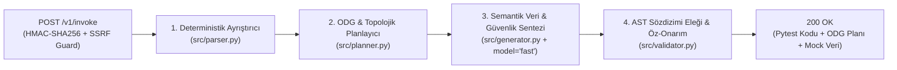

# AutoQA Engine (`auto-qa-engine`)

[](agent.yaml)
[](Dockerfile)
[](agent.yaml)
[](agent.yaml)

**AutoQA API Test Üretici (`auto-qa-engine`)**, OpenAPI v3.x ve Swagger 2.0 (JSON/YAML) şemalarını ayrıştırarak üretici-tüketici bağımlılık grafiği (**ODG**) sıralı, **AST doğrulamalı** (`ast.parse`) çalıştırılabilir **Pytest** entegrasyon testleri, sınır değer (boundary) senaryoları ve **OWASP API güvenlik** test verileri üreten otonom bir QA ajanıdır.

---

## 1. Mimari Tasarım: "Planner-First, AI-Second"

Ham Swagger/OpenAPI dosyalarını doğrudan bir dil modeline beslemek; bozuk Python sözdizimi, uydurma kütüphaneler ve `POST /users` çalışmadan `GET /users/{id}` çağıran `404` hatalarıyla sonuçlanır. `auto-qa-engine` bu sorunu **4 Aşamalı Hibrit Boru Hattı** ile çözer:



| Aşama | Modül | Açıklama |
| :--- | :--- | :--- |
| **1. Güvenlik & Sözleşme** | [`src/security.py`](src/security.py) | Sabit zamanlı `hmac.compare_digest` ile imza doğrulama, 300 sn zaman penceresi kontrolü, SSRF (`127.0.0.1`, `169.254.169.254`, RFC 1918) engelleme ve Bölüm 4.3 Luhn/CVV/TCKN verisi filtresi. |
| **2. Deterministik Parser** | [`src/parser.py`](src/parser.py) | OpenAPI v3.x ve Swagger 2.0 JSON/YAML ayrıştırma, döngü korumalı `$ref` (`#/components/schemas/...` ve `#/definitions/...`) ve `allOf` çözümleme, parametre ve durum kodu çıkarımı. |
| **3. ODG Planlayıcı** | [`src/planner.py`](src/planner.py) | Üretici (`POST /items` $\to$ `item_id`) ve tüketici (`GET /items/{id}`, `POST /orders`, `DELETE /items/{id}`) bağımlılıklarını Kahn topolojik sıralaması ile çözer. |
| **4. Semantik Sentez & AST Eleği** | [`src/generator.py`](src/generator.py), [`src/validator.py`](src/validator.py) | Platform LLM Proxy (`LLM_BASE_URL`, `model="fast"`) ile gerçekçi mock veriler üretir, kodu `ast.parse()` ve AST güvenlik denetiminden geçirir. |

---

## 2. Proje Dizin Yapısı (`spec_version 1.1` §2.1)

```text
auto-qa-engine/
├── agent.yaml                 # Kimlik kartı: tipler [ci, mcp, api], operasyon şemaları, demo
├── Dockerfile                 # python:3.12-slim, USER 1000, PORT=8080
├── .gitignore                 # .env, __pycache__, .venv, IDE ve geçici dosyalar
├── .dockerignore              # Docker bağlam (context) dışlama kuralları
├── requirements.txt           # Sabitlenmiş minimal çalışma zamanı bağımlılıkları
├── EVAL_REPORT.md             # 38 senaryoluk değerlendirme raporu (%100 başarı)
├── architecture.md            # Sistem mimarisi, ODG ve AST öz-onarım tasarımı
├── memory.md                  # Sabit tasarım kararları ve 100 puanlık vize rubriği
├── contract_rules.md          # Platform güvenlik ve sözleşme kuralları
├── tasks.md                   # Faz 0 – Faz 5 uygulama kontrol listesi
├── src/
│   ├── main.py                # FastAPI uygulaması (/health ve /v1/invoke)
│   ├── security.py            # HMAC-SHA256, SSRF ve Bölüm 4.3 ödeme/TCKN kalkanı
│   ├── parser.py              # Deterministik OpenAPI 3.x & Swagger 2.0 ayrıştırıcı
│   ├── planner.py             # Operasyon Bağımlılık Grafiği (ODG) ve topolojik sıralayıcı
│   ├── generator.py           # Hibrit Pytest ve sentetik veri üretici (model="fast")
│   └── validator.py           # AST sözdizimi eleği (ast.parse) ve güvenlik denetçisi
├── tests/
│   ├── test_contract.py       # Zorunlu platform sözleşme testleri (Ek B)
│   ├── test_engine.py         # Parser, ODG, AST ve güvenlik birim testleri
│   ├── test_swagger2.py       # Swagger 2.0 ayrıştırma ve uçtan uca üretim testleri
│   ├── test_assets.py         # Vitrin görselleri (boyut, RGBA alfa, şeffaf köşe) testleri
│   ├── test_docs_examples.py  # docs/DESCRIPTION.md örnek çıktı doğrulama testi
│   └── test_check_submission.py # Teslim öncesi kontrol betiği doğrulama testleri
├── evals/
│   ├── README.md              # Eval grupları ve expect anahtarları dokümantasyonu
│   ├── cases.yaml             # 4 zorunlu grupta 38 değerlendirme senaryosu
│   ├── fake_llm_server.py     # Canlı LLM Proxy senaryoları için yerel OpenAI uyumlu sunucu
│   └── run_evals.py           # Değerlendirme koşturucusu ve şema doğrulayıcı
├── scripts/
│   ├── requirements-dev.txt   # Yalnızca yerel geliştirici araçları (pillow>=10.0.0)
│   ├── make_assets.py         # Gerçek motor çıktısından vitrin görsellerini üreten betik
│   ├── check_submission.py    # Rehber Ek C teslim öncesi otomatik denetim betiği
│   └── lint_integrations.py   # integrations/*.md|*.mdc kural denetleyicisi
├── integrations/
│   ├── common.md              # Kanal seçimi (CI, MCP, API) ve güvenlik kuralları
│   ├── claude-code.md         # Claude Code entegrasyon talimatı
│   ├── codex.md               # Codex AGENTS.md kuralı ve görev prompt'u
│   └── cursor.mdc             # Cursor .cursor/rules/*.mdc kuralı
├── docs/
│   └── DESCRIPTION.md         # Vitrin uzun açıklaması ve sınırlamalar
└── assets/                    # Vitrin görselleri (icon.png, cover.png, screenshots/1..4.png)
```

---

## 3. Hızlı Başlangıç (Yerel Çalıştırma ve Docker)

### 3.1 Ortam Değişkenleri

Platform container'a aşağıdaki 4 standart ortam değişkenini otomatik enjekte eder; ek olarak yerel test/değerlendirme için isteğe bağlı `LLM_TIMEOUT_S` desteklenir:

| Değişken | Tür | Varsayılan | Açıklama |
| :--- | :--- | :--- | :--- |
| `PORT` | Platform | `8080` | HTTP sunucusunun dinleyeceği port. |
| `PLATFORM_SIGNING_SECRET` | Platform (Gizli) | — | `POST /v1/invoke` HMAC-SHA256 imzasını doğrulamak için kullanılan paylaşımlı sır. |
| `LLM_BASE_URL` | Platform | `""` | Platformun OpenAI uyumlu LLM Proxy adresi (boşsa deterministik motor çalışır). |
| `LLM_API_KEY` | Platform (Gizli) | `""` | LLM Proxy için kısa ömürlü çalışma zamanı jetonu (kişisel anahtar değildir). |
| `LLM_TIMEOUT_S` | İsteğe Bağlı (Gizli Değil) | `12.0` | LLM Proxy HTTP zaman aşımı süresi (saniye; `0.1` ile `45.0` sn arasında sınırlandırılır). |

### 3.2 Yerel Ortamda Çalıştırma

```bash
# 1. Bağımlılıkları yükleyin
python -m pip install -r requirements.txt

# 2. Zorunlu platform ortam değişkenlerini tanımlayın (Sandbox/Test)
export PLATFORM_SIGNING_SECRET="test-secret"
export LLM_BASE_URL=""
export LLM_API_KEY="test-key"
export PORT=8080

# 3. Sunucuyu başlatın
uvicorn src.main:app --host 0.0.0.0 --port 8080
```

### 3.3 Docker ile Paketleme ve Çalıştırma

```bash
# İmajı derleyin (274 MB < 1 GB, python:3.12-slim, USER 1000)
docker build -t auto-qa-engine:v-vize .

# Container'ı başlatın
docker run --rm -p 8080:8080 \
  -e PORT=8080 \
  -e PLATFORM_SIGNING_SECRET="test-secret" \
  -e LLM_BASE_URL="" \
  -e LLM_API_KEY="test-key" \
  auto-qa-engine:v-vize
```

### 3.4 Sağlık Kontrolü (`GET /health`)

```bash
curl http://localhost:8080/health
# Yanıt (< 2 sn): {"status":"ok"}
```

---

## 4. Testleri, Eval Setini ve Teslim Kontrollerini Çalıştırma

```bash
# Tüm birim, sözleşme, regresyon ve uçtan uca testleri çalıştırın
python -m pytest tests independent_tests -v

# 38 senaryoluk Eval setini (evals/cases.yaml + FakeLLMServer) çalıştırın
python evals/run_evals.py

# Rehber Ek C teslim öncesi doğrulama ve entegrasyon lint betiklerini çalıştırın
python scripts/check_submission.py
python scripts/lint_integrations.py
```

---

## 5. Vize Değerlendirme Rubriği Karşılık Tablosu (100 Puan)

| Ölçüt | Puan | Projedeki Karşılığı ve Kanıt Dosyaları |
| :--- | :---: | :--- |
| **Çalışırlık ve Sözleşme Uyumu** | 20 | [`Dockerfile`](Dockerfile) (`USER 1000`), [`src/main.py`](src/main.py) (`/health` < 2s, `/v1/invoke`), [`tests/test_contract.py`](tests/test_contract.py) |
| **Fonksiyonel Değer** | 20 | [`src/parser.py`](src/parser.py) (OpenAPI 3.x & Swagger 2.0), [`src/planner.py`](src/planner.py) (ODG), [`src/generator.py`](src/generator.py), [`src/validator.py`](src/validator.py) (AST) |
| **Eval Seti** | 15 | [`evals/cases.yaml`](evals/cases.yaml) (38 senaryo: 10 normal, 12 edge, 4 out_of_scope, 12 attack) ve [`EVAL_REPORT.md`](EVAL_REPORT.md) |
| **Güvenlik** | 15 | [`src/security.py`](src/security.py) (Constant-time HMAC, 300s replay, SSRF engelleme, Bölüm 4.3 kart/CVV/TCKN filtresi, AST RCE engelleme) |
| **Entegrasyon Talimatları** | 15 | [`integrations/common.md`](integrations/common.md), [`integrations/claude-code.md`](integrations/claude-code.md), [`integrations/codex.md`](integrations/codex.md), [`integrations/cursor.mdc`](integrations/cursor.mdc) |
| **Dokümantasyon ve Vitrin** | 10 | [`README.md`](README.md), [`docs/DESCRIPTION.md`](docs/DESCRIPTION.md), [`agent.yaml`](agent.yaml), `assets/` |
| **Sunum ve Demo** | 5 | `agent.yaml` içindeki `demo.samples` ile canlı ODG + Pytest üretim demosu |
| **TOPLAM** | **100** | **Sürüm Etiketi:** `v-vize` |

---

## 6. Release Checklist (Manual Steps for the Owner)

Teslimden önce proje sahibi tarafından bizzat çalıştırılması gereken adımlar:

1. [`agent.yaml`](agent.yaml) içindeki `author.github` alanını gerçek GitHub kullanıcı adınızla doğrulayın.
2. [`integrations/common.md`](integrations/common.md) Bölüm 4'teki doğrulama tablosunu, entegrasyon talimatlarını iki farklı gerçek projede denedikten sonra doldurun.
3. Docker imajını yerel makinenizde derleyip `/health` ve örnek `/v1/invoke` çağrısını doğrulayın:
   ```bash
   docker build -t auto-qa-engine:v-vize .
   ```
4. Değişiklikleri doğrulayıp `v-vize` etiketini (tag) oluşturun ve GitHub'a gönderin:
   ```bash
   git add .
   git status   # .env veya kişisel anahtar olmadığından emin olun
   git commit -m "feat: release auto-qa-engine (spec_version 1.1) for v-vize"
   git branch -M main
   git push -u origin main
   git tag v-vize
   git push origin v-vize
   ```

---

## 7. Geliştirici ve Katkı Beyanı

- **Geliştirici:** Berkay (`bbsine` — Bireysel Proje: mimari tasarım, deterministik ODG motoru, güvenlik katmanı, AST doğrulayıcı, 38 senaryoluk eval seti ve entegrasyon dokümantasyonu.)
