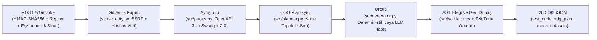

# AutoQA Engine (`auto-qa-engine`)

AutoQA Engine, bir OpenAPI 3.0 / 3.1 veya Swagger 2.0 spesifikasyonunu (JSON ya da YAML metni) bağımlılık sıralı, sözdizimi doğrulanmış Pytest entegrasyon testlerine, sentetik istek verilerine ve AST tabanlı kapsama raporlarına dönüştüren bir FastAPI servisidir (`spec_version: "1.1"`, Python 3.12 container).

**Dil:** [English](README.md) | Türkçe

**İçindekiler**

- [1. Bir bakışta](#1-bir-bakışta)
- [2. Nedir ve ne değildir](#2-nedir-ve-ne-değildir)
- [3. Hızlı başlangıç (iki dakika)](#3-hızlı-başlangıç-iki-dakika)
- [4. Nasıl çalışır](#4-nasıl-çalışır)
- [5. API referansı](#5-api-referansı)
- [6. Yapılandırma](#6-yapılandırma)
- [7. CI, AI kodlama araçları veya kendi kodunuzdan kullanım](#7-ci-ai-kodlama-araçları-veya-kendi-kodunuzdan-kullanım)
- [8. Uçtan uca örnek](#8-uçtan-uca-örnek)
- [9. Güvenlik modeli](#9-güvenlik-modeli)
- [10. Sınırlar ve çalışma metrikleri](#10-sınırlar-ve-çalışma-metrikleri)
- [11. Bilinen sınırlamalar](#11-bilinen-sınırlamalar)
- [12. Testler ve kalite doğrulaması](#12-testler-ve-kalite-doğrulaması)
- [13. Proje dizin yapısı](#13-proje-dizin-yapısı)
- [14. Sorun giderme ve SSS](#14-sorun-giderme-ve-sss)
- [15. Sürümleme ve katkı rehberi](#15-sürümleme-ve-katkı-rehberi)
- [16. Yazarlar ve katkılar](#16-yazarlar-ve-katkılar)
- [17. Proje sahibi için yapılacaklar (Owner TODOs)](#17-proje-sahibi-için-yapılacaklar-owner-todos)

---

## 1. Bir bakışta

| Özellik | Değer |
| :--- | :--- |
| **Girdi** | Metin olarak verilen OpenAPI 3.0 / 3.1 veya Swagger 2.0 şeması (`openapi_spec`, JSON veya YAML), isteğe bağlı hedef `base_url` ve kapsama analizi için mevcut Pytest kodu (`existing_test_code`) |
| **Çıktılar** | Çalıştırılabilir Pytest dosyası (`pytest_code` / `test_code` + `test_generated_api.py` artefaktı), Operasyon Bağımlılık Grafiği (`odg_plan`), mock/sınır/güvenlik verileri (`mock_datasets`) ve kapsama raporları |
| **Desteklenen şema özellikleri** | OpenAPI 3.0 / 3.1 (`requestBody`, `components/schemas`, `servers`), Swagger 2.0 (`in: body`, `in: formData`, `definitions`, `basePath`), yerel `#/...` `$ref` ve `allOf` birleştirme |
| **Gövde kodlamaları** | `application/json` (`json=`), `application/x-www-form-urlencoded` (`data=`), `multipart/form-data` (`data=` + bellek içi `(dosya_adi, bayt, medya_turu)` ile `files=`) |
| **Üretilen test çatıları** | `pytest-httpx` (varsayılan) veya `pytest-requests`; üretilen testleri çalıştırmak için Python >= 3.10, `pytest>=8.0.0` ve `httpx>=0.27.0` ya da `requests>=2.31.0` gerekir |
| **Servis çalışma zamanı** | FastAPI + Uvicorn (`python:3.12-slim`, root dışı `USER 1000`, `PORT=8080`, LLM olmadan tam deterministik veya OpenAI uyumlu proxy ile çalışır) |
| **Uç noktalar** | `GET /health` ve HMAC imzalı `POST /v1/invoke` (`generate_tests`, `generate_mocks`, `analyze_coverage`) |

---

## 2. Nedir ve ne değildir

Ham bir OpenAPI şemasını doğrudan genel amaçlı bir büyük dil modeline (LLM) verip test yazdırmak; sözdizimi hatalı Python kodları, var olmayan yardımcı kütüphaneler, `POST /users` çalışmadan `GET /users/{id}` çağırdığı için düşen `404 Not Found` yanıtları ve yalnızca durum kodunu kontrol eden zayıf doğrulamalarla sonuçlanır. AutoQA Engine bu sorunu **Önce Planlayıcı, Sonra Yapay Zekâ (Planner-First, AI-Second)** boru hattıyla çözer: OpenAPI ayrıştırma, **Operasyon Bağımlılık Grafiği (ODG)** sıralaması, kod üretimi ve sözdizimi doğrulama tamamen deterministiktir; isteğe bağlı LLM proxy ise yalnızca örnek verileri zenginleştirir ve gerektiğinde tek turlu sözdizimi onarımı dener.

**Ne değildir:**

- **El yazısı testlerin yerini almaz:** Şema uyumluluğunu, sınır değer mutasyonlarını, enjeksiyon yoklamalarını ve sezgisel sahiplik kontrollerini üretir; iş kurallarına özgü senaryolar için geliştirici testleri yine gereklidir.
- **Hedef API'nizi kendisi çağırmaz:** Container dış hedef ağ erişimi kapalı çalışır (`network.allow: []`); üretilen Python test kodunu kendi yerel ortamınızda veya CI hattınızda çalıştırmanız için bellekte döndürür.
- **URL'lerden şema indirmez:** OpenAPI şemasını `openapi_spec` alanında JSON/YAML metni olarak göndermeniz gerekir. `spec_url`, `webhook_url` vb. uzak adres alanları reddedilir (`422 external_network_disabled` veya `ssrf_blocked`).

---

## 3. Hızlı başlangıç (iki dakika)

Bu adım adım rehber; temiz bir sanal ortamda sunucuyu başlatır, **HMAC-SHA256 (Hash-based Message Authentication Code)** imzalı bir istek gönderir, dönen test dosyasını kaydeder ve yerel bir örnek uygulamaya karşı çalıştırır.

### Adım 1: Sanal ortam oluşturun ve bağımlılıkları kurun

Çalışma zamanı sunucusu yalnızca [requirements.txt](requirements.txt) paketlerini kullanır. Üretilen Pytest kodunu veya depo testlerini çalıştırmak için [scripts/requirements-dev.txt](scripts/requirements-dev.txt) dosyasını da kurun.

Linux / macOS (`bash`):

```bash
python3 -m venv .venv
source .venv/bin/activate
python -m pip install --upgrade pip
python -m pip install -r requirements.txt -r scripts/requirements-dev.txt
```

Windows (`PowerShell`):

```powershell
python -m venv .venv
.\.venv\Scripts\Activate.ps1
python -m pip install --upgrade pip
python -m pip install -r requirements.txt -r scripts/requirements-dev.txt
```

> **Not:** Yalnızca AutoQA Engine HTTP servisini ayağa kaldıracaksanız (ör. üretim veya Docker kurulumunda) `python -m pip install -r requirements.txt` yeterlidir. `pytest`, `httpx` ve `requests` paketleri üretilen test dosyasının çalıştırılması için gereklidir.

### Adım 2: Ortam değişkenlerini ayarlayın ve sunucuyu başlatın

`POST /v1/invoke` uç noktasının imza doğrulayabilmesi için `PLATFORM_SIGNING_SECRET` tanımlanmalıdır. Çevrimdışı deterministik modda çalışmak için `LLM_BASE_URL` değerini boş bırakın.

Linux / macOS (`bash`):

```bash
export PLATFORM_SIGNING_SECRET="local-test-secret"
export LLM_BASE_URL=""
uvicorn src.main:app --host 127.0.0.1 --port 8080
```

Windows (`PowerShell`):

```powershell
$env:PLATFORM_SIGNING_SECRET = "local-test-secret"
$env:LLM_BASE_URL = ""
uvicorn src.main:app --host 127.0.0.1 --port 8080
```

İkinci bir terminalde sunucunun hazır olduğunu doğrulayın:

```bash
curl http://127.0.0.1:8080/health
# Beklenen yanıt:
# {"status":"ok"}
```

### Adım 3: İmzalı bir istek gönderin (Python örneği)

Çalışan sunucuya karşı bu tek dosyalık betiği çalıştırın (veya `quick_start.py` olarak kaydedip `python quick_start.py` ile çalıştırın). Ham JSON gövdesini HMAC-SHA256 ile imzalar, `http://127.0.0.1:9000` adresini hedefleyen iki uç noktalı Items API için `generate_tests` çağırır, özeti yazdırır ve `test_generated_api.py` dosyasını oluşturur:

```python
import hashlib
import hmac
import json
import os
import time
import urllib.request

SECRET = os.environ.get("PLATFORM_SIGNING_SECRET", "local-test-secret").encode("utf-8")
TINY_SPEC = """
openapi: "3.0.3"
info: {title: Items API, version: "1.0.0"}
paths:
  /items:
    post:
      operationId: create_item
      requestBody:
        required: true
        content:
          application/json:
            schema:
              type: object
              required: [name]
              properties:
                name: {type: string, minLength: 2}
      responses:
        "201": {description: Created}
  /items/{id}:
    get:
      operationId: get_item
      parameters:
        - {name: id, in: path, required: true, schema: {type: string}}
      responses:
        "200": {description: OK}
""".strip()

payload = json.dumps(
    {
        "operation": "generate_tests",
        "input": {
            "openapi_spec": TINY_SPEC,
            "base_url": "http://127.0.0.1:9000",
        },
    }
).encode("utf-8")

ts = str(int(time.time()))
sig = hmac.new(SECRET, ts.encode("utf-8") + b"." + payload, hashlib.sha256).hexdigest()

req = urllib.request.Request(
    "http://127.0.0.1:8080/v1/invoke",
    data=payload,
    method="POST",
    headers={
        "Content-Type": "application/json",
        "X-Platform-Timestamp": ts,
        "X-Platform-Signature": sig,
        "X-Tenant-Id": "demo-tenant",
        "X-Request-Id": "req-quickstart-1",
    },
)

with urllib.request.urlopen(req, timeout=30) as resp:
    result = json.loads(resp.read().decode("utf-8"))

print("HTTP:", resp.status, "status:", result["status"])
print("Summary:", json.dumps(result["output"]["summary"], indent=2))
with open("test_generated_api.py", "w", encoding="utf-8") as fh:
    fh.write(result["output"]["test_code"])
```

#### Shell (`curl` + `openssl`) alternatifi

```bash
export PLATFORM_SIGNING_SECRET="local-test-secret"
cat <<'EOF' > payload.json
{"operation":"generate_tests","input":{"openapi_spec":"openapi: '3.0.3'\ninfo: {title: Items API, version: '1.0.0'}\npaths:\n  /items:\n    post:\n      operationId: create_item\n      requestBody:\n        required: true\n        content:\n          application/json:\n            schema:\n              type: object\n              required: [name]\n              properties:\n                name: {type: string, minLength: 2}\n      responses:\n        '201': {description: Created}\n  /items/{id}:\n    get:\n      operationId: get_item\n      parameters: [{name: id, in: path, required: true, schema: {type: string}}]\n      responses:\n        '200': {description: OK}\n","base_url":"http://127.0.0.1:9000"}}
EOF

TS=$(date +%s)
SIG=$( (printf '%s.' "$TS"; cat payload.json) | openssl dgst -sha256 -hmac "$PLATFORM_SIGNING_SECRET" -hex | awk '{print $NF}' )

curl -sS -X POST "http://127.0.0.1:8080/v1/invoke" \
  -H "Content-Type: application/json" \
  -H "X-Platform-Timestamp: $TS" \
  -H "X-Platform-Signature: $SIG" \
  -H "X-Tenant-Id: demo-tenant" \
  -H "X-Request-Id: req-curl-1" \
  --data-binary "@payload.json"
```

<details>
<summary>Temiz sanal ortamdan alınan gerçek yanıt özeti (POST /v1/invoke, deterministik mod)</summary>

```json
{
  "status": "ok",
  "output": {
    "summary": {
      "total_endpoints": 2,
      "total_operations": 2,
      "generated_test_count": 5,
      "positive_tests": 2,
      "negative_boundary_tests": 1,
      "security_injection_tests": 2,
      "ast_valid": true,
      "self_healed": false,
      "estimated_coverage_pct": 100.0
    },
    "odg_plan": [
      {
        "step": 1,
        "operation_id": "create_item",
        "method": "POST",
        "path": "/items",
        "produces": ["item_id"],
        "consumes": []
      },
      {
        "step": 2,
        "operation_id": "get_item",
        "method": "GET",
        "path": "/items/{id}",
        "produces": [],
        "consumes": ["item_id"]
      }
    ]
  }
}
```

</details>

### Adım 4: Üretilen test dosyasını yerel bir uygulamaya karşı çalıştırın

Bu küçük örnek FastAPI uygulamasını `items_app.py` olarak kaydedin:

```python
from fastapi import FastAPI, HTTPException
from pydantic import BaseModel, Field

class ItemIn(BaseModel):
    name: str = Field(min_length=2)

app = FastAPI()
items: dict[str, dict[str, str]] = {}

@app.post("/items", status_code=201)
def create_item(item: ItemIn):
    items["itm-1"] = {"id": "itm-1", "name": item.name}
    return items["itm-1"]

@app.get("/items/{id}")
def get_item(id: str):
    if id not in items:
        raise HTTPException(404)
    return items[id]
```

Hedef uygulamayı `9000` portunda başlatın (Adım 3'teki `"base_url": "http://127.0.0.1:9000"` ile eşleşir), ardından `pytest test_generated_api.py -v` komutunu çalıştırın:

```bash
uvicorn items_app:app --host 127.0.0.1 --port 9000
# Başka bir terminalde:
pytest test_generated_api.py -v
```

<details>
<summary>Yerel FastAPI uygulamasına karşı gerçek pytest çıktısı (5 passed in 0.21s)</summary>

```text
============================= test session starts =============================
collected 5 items

test_generated_api.py::test_step_01_create_item_positive PASSED           [ 20%]
test_generated_api.py::test_step_01_create_item_negative_boundary PASSED  [ 40%]
test_generated_api.py::test_step_01_create_item_security_injection PASSED [ 60%]
test_generated_api.py::test_step_02_get_item_positive PASSED              [ 80%]
test_generated_api.py::test_step_02_get_item_security_unknown_id_and_auth PASSED [100%]

============================== 5 passed in 0.21s ==============================
```

</details>

---

## 4. Nasıl çalışır



| Modül | Dosya Yolu | Çalışma Modu | Sorumluluk |
| :--- | :--- | :--- | :--- |
| İstek ağ geçidi | [`src/main.py`](src/main.py) | Deterministik | FastAPI yönlendirme (`GET /health`, `POST /v1/invoke`), sınırlı eşzamanlılık (`asyncio.Semaphore(2)` + 2 işçili executor), vekil karakter/kodlama denetimi, hata zarfı üretimi |
| Güvenlik ve sözleşme katmanı | [`src/security.py`](src/security.py) | Deterministik | Sabit zamanlı HMAC-SHA256 doğrulama (`300s` zaman penceresi), **SSRF (Server-Side Request Forgery)** IP/alan adı doğrulayıcısı, kart (**IIN** + Luhn), CVV/son kullanma ve **TCKN** sağlama tarayıcıları |
| OpenAPI ayrıştırıcı | [`src/parser.py`](src/parser.py) | Deterministik | Özel alias izleyicili `yaml.SafeLoader`, düğüm/derinlik/bütçe sınırları, OpenAPI 3.0 / 3.1 + Swagger 2.0 normalizasyonu, yerel `#/...` `$ref` ve `allOf` çözümü, `basePath` çıkarımı |
| ODG planlayıcı | [`src/planner.py`](src/planner.py) | Deterministik | Kaynak kimliği üretici/tüketici çıkarımı, alt-kaynaktan üst-kaynağa `DELETE` kısıtları, metot öncelikli Kahn topolojik sıralaması |
| Boru hattı ve veri sentezleyici | [`src/generator.py`](src/generator.py) | Deterministik + isteğe bağlı LLM | Şema kısıtlı pozitif/sınır/enjeksiyon verileri, isteğe bağlı OpenAI uyumlu `model="fast"` zenginleştirme (`jsonschema` doğrulamalı), tek turlu LLM sözdizimi onarımı, AST tabanlı kapsama analizi |
| Kod üretici ve AST eleği | [`src/validator.py`](src/validator.py) | Deterministik | **AST (Soyut Sözdizimi Ağacı)** ayrıştırma ve yasaklı çağrı/içe aktarım denetimi (`eval`, `exec`, `open`, `subprocess`, `socket`), Pytest şablon üretimi (`pytest-httpx` / `pytest-requests`) |

### Temel boru hattı davranışları

- **Operasyon Bağımlılık Grafiği (ODG) sıralaması:** [`src/planner.py`](src/planner.py) yolları, istek gövdelerini ve yanıt şemalarını inceleyerek üretilen kimlikleri (ör. `POST /users` $\to$ `user_id`) ve tüketilen yol/gövde parametrelerini (ör. `GET /users/{id}` $\to$ `user_id`) çıkarır. İşlemleri `POST -> GET -> PUT -> PATCH -> DELETE` önceliğiyle Kahn topolojik sıralamasıyla planlar; alt kaynak silme uç noktalarının (`/users/{user_id}/orders/{id}`) üst kaynak silme uç noktalarından (`/users/{id}`) önce çalışmasını zorunlu kılar.
- **`ODG_STATE` yakalama ve üretici hatasında atlama:** Üretilen her pozitif `POST` testi, ürettiği değişken adlarını `ATTEMPTED_PRODUCERS` kümesine ekler, isteği gönderir ve yanıttaki ortak anahtarlardan (`id`, `uuid`, `<kaynak>_id` vb.) aldığı kimliği modül düzeyindeki `ODG_STATE` sözlüğüne yazar. Bu kimlikleri tüketen sonraki adımlar `ATTEMPTED_PRODUCERS` ile `ODG_STATE`'i karşılaştırır; üretici kimliği yakalayamamışsa sahte kimlikle yanıltıcı hata üretmek yerine `pytest.skip("Producer step did not capture: ...")` çağrısı yapar.
- **Bilinmeyen kimlik ve geçersiz yetki yoklamaları (`*_security_unknown_id_and_auth`):** Yol parametresi bağlayan veya OpenAPI `security` tanımı içeren operasyonlarda (aynı adımda gövde enjeksiyon testi yoksa), yol parametresine `nonexistent-unauthorized-id-999999` yerleştirip `Authorization: Bearer invalid-token` başlığıyla `(400, 401, 403, 404, 422)` durum kodlarını bekleyen güvenlik yoklaması üretilir.
- **Sezgisel sahiplik doğrulamaları (BOLA kontrolleri):** Bir operasyon yol parametresi (`user_id` vb.) bağladığında, pozitif testler JSON yanıt sözlüğünde yol parametresi adı, `state_key`, `user_id`, `userId` veya `owner_id` anahtarları varsa `str(data[key]) == str(ODG_STATE.get(state_key, ...))` doğrulaması üretir (yanıt şeması hiç tanımlanmamış olsa bile). Bu sezgisel yöntem bu ortak anahtarlar üzerinden **BOLA (Broken Object Level Authorization)** çapraz kullanıcı sızıntılarını yakalar; ancak özel veya iç içe alan adlarını kapsamaz.
- **Form ve multipart gövde kodlaması:** [`src/validator.py`](src/validator.py) medya türüne göre istek argümanı seçer: JSON için `json=`, `application/x-www-form-urlencoded` için `data=` (boolean `true`/`false`, `None` `""`, iç içe nesneler JSON metni olarak), `multipart/form-data` için ise form alanları `data=` ile, `type: file` veya `format: binary`/`byte` alanları disk kullanmayan bellek içi `("sample.txt", b"sample", "text/plain")` demetiyle `files=` olarak gönderilir.
- **Taban yol (`base_url` / `basePath`) birleştirme kuralları:** [`src/generator.py`](src/generator.py) Swagger 2.0 `basePath` veya OpenAPI 3 `servers[0].url` içindeki şablon olmayan yol ön ekini çıkarır:
  - `input.base_url` verilmezse şemadaki sunucu adresi (HTTP/HTTPS ise) veya `http://localhost:8000` kullanılır.
  - `input.base_url` yalnızca kök içeriyorsa (ör. `http://127.0.0.1:8080`), şema ön eki (ör. `/v2`) otomatik eklenir (`http://127.0.0.1:8080/v2`).
  - `input.base_url` zaten bu ön ekle bitiyorsa yinelenmez; başka bir yol içeriyorsa olduğu gibi korunur.
- **Tek turlu LLM onarımı ve deterministik geri dönüş:** Üretilen her Pytest kodu `validate_and_count_assertions` (`ast.parse()` ve `eval`, `exec`, `compile`, `__import__`, `system`, `popen`, `open`, `subprocess`, `pty`, `shutil`, `socket` taraması) ile denetlenir. Hata çıkarsa ve LLM istemcisi etkinse, `attempt_single_turn_ast_repair` `model="fast"` üzerinde `temperature=0.0` ile tek turlu onarım dener. Onarım başarısızsa veya LLM kapalıysa yalnızca pozitif deterministik şablonla (`include_negative_tests=False`, `include_security_tests=False`) yeniden üretilir ve `summary.self_healed = true` atanır.

---

## 5. API referansı

### 5.1 Uç noktalar ve zorunlu başlıklar

| Uç Nokta | Metot | Kimlik Doğrulama | Amaç |
| :--- | :--- | :--- | :--- |
| `/health` | `GET` | Yok | Canlılık yoklaması; işçi havuzunu beklemeden `{"status": "ok"}` (`200 OK`) döndürür (`< 2s` bütçesi) |
| `/v1/invoke` | `POST` | HMAC-SHA256 | OpenAPI metni üzerinde `generate_tests`, `generate_mocks` veya `analyze_coverage` çalıştırır |

**`POST /v1/invoke` istek başlıkları:**

| Başlık | Zorunlu | Açıklama |
| :--- | :--- | :--- |
| `Content-Type` | Evet | `application/json` |
| `X-Platform-Timestamp` | Evet | Saniye cinsinden ASCII tam sayı Unix epoch zaman damgası |
| `X-Platform-Signature` | Evet | `timestamp + "." + ham_govde_baytlari` verisinin küçük harf hex HMAC-SHA256 özeti |
| `X-Tenant-Id` | Önerilen | `request_id` ile birlikte loglanan kiracı kimliği (yoksa `"unknown"`) |
| `X-Request-Id` | Önerilen | Yapılandırılmış sunucu loglarına yazılan istek izleme kimliği (yoksa `"unknown"`) |

### 5.2 İmzalama algoritması ve 300 saniyelik tekrar koruma penceresi

JSON ayrıştırmadan önce [`src/security.py`](src/security.py) içindeki `verify_signature` şunları doğrular:

1. `X-Platform-Timestamp` ve `X-Platform-Signature` mevcut ve ASCII kodlanabilir olmalıdır.
2. `X-Platform-Timestamp` tam sayıya dönüştürülür ve `abs(time.time() - int(ts)) <= 300` koşulu denetlenir.
3. `expected = hmac.new(PLATFORM_SIGNING_SECRET.encode("utf-8"), ts.encode("utf-8") + b"." + ham_baytlar, hashlib.sha256).hexdigest()`.
4. `hmac.compare_digest(expected, sig.strip().lower())` sabit zamanda `True` dönmelidir.

#### Python örneği

```python
import hashlib, hmac, json, os, time, urllib.request

secret = os.environ["PLATFORM_SIGNING_SECRET"].encode("utf-8")
raw_body = json.dumps({"operation": "generate_mocks", "input": {"openapi_spec": "..."}}).encode("utf-8")
ts = str(int(time.time()))
sig = hmac.new(secret, ts.encode("utf-8") + b"." + raw_body, hashlib.sha256).hexdigest()

req = urllib.request.Request(
    "http://127.0.0.1:8080/v1/invoke",
    data=raw_body,
    method="POST",
    headers={
        "Content-Type": "application/json",
        "X-Platform-Timestamp": ts,
        "X-Platform-Signature": sig,
        "X-Tenant-Id": "demo-tenant",
        "X-Request-Id": "req-py-1",
    },
)
with urllib.request.urlopen(req, timeout=30) as resp:
    print(resp.status, resp.read().decode("utf-8"))
```

#### Node.js örneği

```javascript
const crypto = require("node:crypto");

const secret = process.env.PLATFORM_SIGNING_SECRET || "local-test-secret";
const payload = JSON.stringify({
  operation: "generate_tests",
  input: { openapi_spec: "openapi: '3.0.3'\ninfo: {title: Demo, version: '1'}\npaths:\n  /ping:\n    get:\n      responses:\n        '200': {description: OK}\n" },
});
const ts = Math.floor(Date.now() / 1000).toString();
const sig = crypto.createHmac("sha256", secret).update(`${ts}.${payload}`).digest("hex");

fetch("http://127.0.0.1:8080/v1/invoke", {
  method: "POST",
  headers: {
    "Content-Type": "application/json",
    "X-Platform-Timestamp": ts,
    "X-Platform-Signature": sig,
    "X-Tenant-Id": "demo-tenant",
    "X-Request-Id": "req-node-1",
  },
  body: payload,
})
  .then((r) => r.json())
  .then((data) => console.log(data.status, data.output.summary));
```

#### Shell (`curl` + `openssl`) örneği

```bash
TS=$(date +%s)
SIG=$( (printf '%s.' "$TS"; cat payload.json) | openssl dgst -sha256 -hmac "$PLATFORM_SIGNING_SECRET" -hex | awk '{print $NF}' )
curl -sS -X POST "http://127.0.0.1:8080/v1/invoke" \
  -H "Content-Type: application/json" \
  -H "X-Platform-Timestamp: $TS" \
  -H "X-Platform-Signature: $SIG" \
  -H "X-Tenant-Id: demo-tenant" \
  -H "X-Request-Id: req-sh-1" \
  --data-binary "@payload.json"
```

### 5.3 İstek ve yanıt zarfı

**İstek gövdesi:**

```json
{
  "operation": "generate_tests | generate_mocks | analyze_coverage",
  "input": {},
  "config": {}
}
```

**Başarılı yanıt (`HTTP 200`):**

```json
{
  "output": {},
  "status": "ok | fail | needs_review",
  "artifacts": [],
  "actions": []
}
```

**Her `status` değerinin dönme koşulları:**

| `status` | Hangi operasyondan döner | Koşul |
| :--- | :--- | :--- |
| `"ok"` | Üç operasyon da | `generate_tests`: `summary.ast_valid == true` ve (`not config.fail_on_missing_auth` veya hedeflenen tüm operasyonlarda OpenAPI `security` tanımlı). `generate_mocks`: her zaman `"ok"`. `analyze_coverage`: `coverage_pct >= min_coverage_pct` (veya `min_threshold <= 0` / kapsam dışı işlem yok) ve yetki kontrolü geçerse. |
| `"fail"` | `analyze_coverage` | `coverage_pct < min_coverage_pct` (`existing_test_code` boşsa ve `min_coverage_pct > 0` iken kapsanmayan operasyon varsa dahil). CI'da `fail-on: fail` kapısını düşürmek için kullanılır. |
| `"needs_review"` | `generate_tests`, `analyze_coverage` | `ast_valid` değeri `false` ise veya `config.fail_on_missing_auth` `true` iken en az bir operasyonda OpenAPI `security` tanımı yoksa (`analyze_coverage` aksi hâlde `"ok"` olacaktıysa). |

**Hata yanıtı (`HTTP 4xx / 5xx`):**

```json
{
  "error": {
    "code": "snake_case_error_code",
    "message": "Açıklayıcı hata metni"
  }
}
```

### 5.4 Operasyonlar

#### `generate_tests`

OpenAPI/Swagger şemasını ayrıştırır, ODG çalışma sırasını çıkarır, verileri sentezler ve AST doğrulamalı Pytest kodu üretir ([`agent.yaml`](agent.yaml) içinde `timeout_s: 60`).

**Girdi alanları (`input`):**

| Alan | Tip | Zorunlu | Varsayılan | Kısıtlar ve notlar |
| :--- | :--- | :--- | :--- | :--- |
| `openapi_spec` | `string` | Evet | — | `minLength: 10`; ham JSON veya YAML OpenAPI 3.x / Swagger 2.0 metni |
| `base_url` | `string` | Hayır | `"http://localhost:8000"` | Üretilen test dosyasında `BASE_URL` olarak yer alacak hedef API adresi (boşsa şemadaki `servers[0].url` kullanılır) |
| `include_negative_tests` | `boolean` | Hayır | `true` | Yazma uç noktaları (`POST`, `PUT`, `PATCH`) için `_negative_boundary` (`400`/`422`) testlerini üretir |
| `include_security_tests` | `boolean` | Hayır | `true` | `_security_injection` (SQLi/XSS) ve `_security_unknown_id_and_auth` yoklamalarını üretir |
| `target_endpoints` | `array[string]` | Hayır | `null` (tümü) | Test üretimini yalnızca eşleşen OpenAPI yollarıyla sınırlar |

**Çıktı alanları (`output`) ve artefaktlar:**

- `summary`: `total_endpoints` (int), `total_operations` (int), `generated_test_count` (int), `positive_tests` (int), `negative_boundary_tests` (int), `security_injection_tests` (int), `ast_valid` (bool), `self_healed` (bool), `estimated_coverage_pct` (number; `target_endpoints` filtresi öncesi tüm şema operasyon sayısına bölünerek hesaplanır)
- `odg_plan`: `{step, operation_id, method, path, produces, consumes}` nesnelerinden oluşan sıralı dizi
- `pytest_code` / `test_code` (eşdeğer metinler): tam Pytest modülü kodu
- `mock_datasets` / `mock_data`: `operation_id` anahtarlı pozitif, sınır ve güvenlik veri kümeleri
- `endpoints_covered`: kapsanan yol listesi
- `total_assertions`: AST içindeki toplam `assert` sayısı
- `artifacts`: `[{"name": "test_generated_api.py", "mime_type": "text/x-python", "content": "<test_code>"}]`

Örnek istek/yanıt çifti için yukarıdaki [Adım 3](#adım-3-imzalı-bir-istek-gönderin-python-örneği) bölümüne bakın.

#### `generate_mocks`

Pytest dosyası üretmeden yalnızca şema uyumlu pozitif, sınır ve enjeksiyon veri setleri üretir ([`agent.yaml`](agent.yaml) içinde `timeout_s: 30`, `artifacts: []`).

**Girdi alanları (`input`):**

| Alan | Tip | Zorunlu | Varsayılan | Kısıtlar ve notlar |
| :--- | :--- | :--- | :--- | :--- |
| `openapi_spec` | `string` | Evet | — | `minLength: 10`; JSON veya YAML OpenAPI 3.x / Swagger 2.0 metni |
| `count` | `integer` | Hayır | `3` | Her operasyon için üretilecek geçerli örnek (`valid_samples`) sayısı; şema üst sınırı `maximum: 20` |

**Çıktı alanları (`output`):**

- `total_operations` (`integer`)
- `mock_datasets` (`operation_id` anahtarlı `valid_payload`, `valid_samples`, `boundary_payloads`, `security_payloads` nesneleri)

<details>
<summary>Temiz sanal ortamdan alınan gerçek generate_mocks istek ve yanıtı</summary>

İstek:

```json
{
  "operation": "generate_mocks",
  "input": {
    "openapi_spec": "openapi: '3.0.3'\ninfo: {title: Items API, version: '1.0.0'}\npaths:\n  /items:\n    post:\n      operationId: create_item\n      requestBody:\n        required: true\n        content:\n          application/json:\n            schema:\n              type: object\n              required: [name]\n              properties:\n                name: {type: string, minLength: 2}\n      responses:\n        '201': {description: Created}",
    "count": 2
  }
}
```

Yanıt:

```json
{
  "output": {
    "total_operations": 1,
    "mock_datasets": {
      "create_item": {
        "valid_payload": {
          "name": "Ayşe Yılmaz"
        },
        "valid_samples": [
          {
            "name": "Ayşe Yılmaz"
          },
          {
            "name": "Ayşe Yılmaz 2"
          }
        ],
        "boundary_payloads": [
          {},
          {
            "name": ""
          }
        ],
        "security_payloads": [
          {
            "name": "'; DROP TABLE users; -- <script>alert(1)</script>"
          }
        ]
      }
    }
  },
  "status": "ok",
  "artifacts": [],
  "actions": []
}
```

</details>

#### `analyze_coverage`

OpenAPI şemasını ve isteğe bağlı mevcut Pytest kodunu Python AST çağrı düğümleri bazında inceler, kapsanan/kapsanmayan operasyonları ve önerileri döndürür ([`agent.yaml`](agent.yaml) içinde `timeout_s: 30`, `artifacts: []`).

**Girdi alanları (`input`):**

| Alan | Tip | Zorunlu | Varsayılan | Kısıtlar ve notlar |
| :--- | :--- | :--- | :--- | :--- |
| `openapi_spec` | `string` | Evet | — | `minLength: 10`; JSON veya YAML OpenAPI 3.x / Swagger 2.0 metni |
| `existing_test_code` | `string` | Hayır | `""` | İncelenecek mevcut Pytest kodu; en fazla `200,000` UTF-8 baytı ve `80` AST derinliği |

**Çıktı alanları (`output`):**

- `coverage_pct` (`number`), `total_operations` (`integer`), `covered_operations` (`array[string]`), `uncovered_operations` (`array[string]`), `recommendations` (`array[string]`)

<details>
<summary>Temiz sanal ortamdan alınan gerçek analyze_coverage istek ve yanıtı</summary>

İstek:

```json
{
  "operation": "analyze_coverage",
  "config": {
    "min_coverage_pct": 80
  },
  "input": {
    "openapi_spec": "openapi: '3.0.3'\ninfo: {title: Items API, version: '1.0.0'}\npaths:\n  /items:\n    post:\n      operationId: create_item\n      responses:\n        '201': {description: Created}\n  /items/{id}:\n    get:\n      operationId: get_item\n      parameters: [{name: id, in: path, required: true, schema: {type: string}}]\n      responses:\n        '200': {description: OK}",
    "existing_test_code": "def test_create_item(client):\n    r = client.post('/items', json={'name': 'Kalem'})\n    assert r.status_code == 201\n"
  }
}
```

Yanıt (`50.0 < 80` olduğu için `status: "fail"`):

```json
{
  "output": {
    "coverage_pct": 50.0,
    "total_operations": 2,
    "covered_operations": [
      "create_item"
    ],
    "uncovered_operations": [
      "get_item"
    ],
    "recommendations": [
      "GET /items/{id} (get_item) için pozitif ve sınır değer (400/422) testleri eksik."
    ]
  },
  "status": "fail",
  "artifacts": [],
  "actions": []
}
```

</details>

### 5.5 Hata referansı

`src/` tarafından döndürülen her hata `{"error": {"code": "...", "message": "..."}}` biçimindedir. Programatik kontrollerde `message` metnine değil HTTP durum kodu ve `error.code` değerine göre işlem yapın.

| HTTP Durumu | `error.code` | Ne zaman oluşur | Nasıl düzeltilir |
| :--- | :--- | :--- | :--- |
| `400` | `bad_request` | Çatı düzeyinde `HTTPException(400)` | İstek biçimini ve başlıkları kontrol edin |
| `401` | `invalid_timestamp` | `X-Platform-Timestamp` eksik, ASCII dışı, tam sayı değil veya `abs(now - ts) > 300` | Sistem saatini NTP ile eşitleyin ve güncel tam sayı epoch saniyesiyle imzalayın |
| `401` | `invalid_signature` | `X-Platform-Signature` eksik, ASCII dışı veya `HMAC-SHA256(secret, ts + "." + raw_bytes)` ile uyuşmuyor | Gönderilen ham UTF-8 gövde baytlarını aynı `PLATFORM_SIGNING_SECRET` ile imzalayın |
| `401` | `unauthorized` | `"timestamp"` veya `"signature"` bağlamı olmayan genel `401` hatası | Geçerli HMAC imzalama başlıklarını ekleyin |
| `404` | `not_found` | Yol `/health` veya `/v1/invoke` ile eşleşmiyor | Operasyon isteklerini `POST /v1/invoke`, sağlık kontrolünü `GET /health` adresine gönderin |
| `405` | `method_not_allowed` | Yanlış HTTP metodu (ör. `GET /v1/invoke` veya `POST /health`) | `/health` için `GET`, `/v1/invoke` için `POST` kullanın |
| `4xx / 5xx` | `http_<status_code>` | [`src/main.py`](src/main.py) içindeki diğer `StarletteHTTPException` durumları için geri dönüş kodu (ör. `http_415`) | HTTP durum kodunu ve istek başlıklarını inceleyin |
| `422` | `validation_error` | FastAPI `RequestValidationError`, `HTTPException(422)` veya `^[a-z][a-z0-9_]{1,63}$` desenine uymayan `ValueError` | JSON alan tiplerini ve değer kısıtlarını doğrulayın |
| `422` | `invalid_json` | İstek gövdesi boş, geçersiz JSON veya JSON nesnesi dışında bir tip (dizi/skaler) | Geçerli bir UTF-8 JSON nesnesi `{"operation": ..., "input": ...}` gönderin |
| `422` | `invalid_encoding` | İstek JSON'u veya YAML içeriği tekil UTF-16 vekil (surrogate, ör. `\ud800`) karakter içeriyor veya `UnicodeError` tetikliyor | Metinlerin tekil vekil karakter içermeyen geçerli UTF-8 olduğundan emin olun |
| `422` | `unknown_operation` | `operation` eksik, string değil veya `generate_tests`, `generate_mocks`, `analyze_coverage` dışında | Desteklenen üç operasyon adından birini gönderin |
| `422` | `prohibited_sensitive_data` | Girdi, config, şema (Unicode kaçış çözümlemesi sonrası dahil) veya `existing_test_code` içinde PAN (IIN + Luhn), CVV/son kullanma/banka şifresi veya geçerli 11 haneli TCKN tespit edildi | Gerçek/Luhn-geçerli kart numaralarını, CVV/son kullanma çiftlerini ve geçerli TCKN'leri kaldırıp sahte örnek değerler kullanın |
| `422` | `ssrf_blocked` | `base_url` (veya `spec_url`/`webhook_url` vb.) engelli adres (`169.254.169.254`, `metadata.google.internal`, `0.0.0.0`, kullanıcı `base_url` içinde `.internal` veya RFC 1918) ya da güvensiz protokol (`file://`, `ftp://`, `gopher://`) içeriyor | Genel HTTPS adresi veya yerel `base_url` hedefleri için `http(s)://localhost` / `127.0.0.1` / `::1` kullanın |
| `422` | `external_network_disabled` | İstek `spec_url`, `katalog_url`, `webhook_url`, `callback_url` veya `target_url` içeriyor | Uzak URL alanlarını kaldırın ve şema metnini doğrudan `input.openapi_spec` içinde gönderin |
| `422` | `empty_openapi_spec` | `openapi_spec` boş veya yalnızca boşluk karakterlerinden oluşuyor | Dolu bir JSON veya YAML OpenAPI spesifikasyonu gönderin |
| `422` | `invalid_openapi_syntax` | JSON/YAML ayrıştırma hatası (`yaml.YAMLError` / `json.JSONDecodeError`) veya döngüsel YAML alias referansı (`&a ... *a`) | YAML/JSON sözdizimini düzeltin ve döngüsel YAML aliaslarını kaldırın |
| `422` | `spec_too_large` | Şema derinlik `MAX_SCHEMA_DEPTH * 2` (`80`), `MAX_ALIAS_EXPANDED_NODES` (`120,000`), `MAX_SPEC_TOTAL_NODES` (`150,000`) veya `$ref` genişleme `MAX_REF_EXPANSION_NODES` (`120,000`) sınırını aşıyor | Büyük spesifikasyonları mikroservis bazında bölün veya aşırı alias/`$ref` çoğaltmasını azaltın |
| `422` | `invalid_openapi_type` | `openapi_spec` string veya nesne değil (ör. liste veya tam sayı) | `openapi_spec` alanını YAML veya JSON metin olarak gönderin |
| `422` | `invalid_openapi_root` | Ayrıştırılan JSON/YAML kökü bir eşleme (mapping/object) değil | Kök düzeyde `openapi`/`swagger`, `info`, `paths` anahtarları bulunduğundan emin olun |
| `422` | `missing_paths` | `paths` anahtarı yok, nesne değil veya `{}` şeklinde boş | `paths` altına en az bir uç nokta ekleyin |
| `422` | `no_operations_found` | `paths` içinde desteklenen HTTP metodu yok veya `target_endpoints` tüm operasyonları dışarıda bıraktı | Geçerli HTTP metotları (`get`, `post`, `put`, `patch`, `delete`, `options`, `head`) ekleyin veya `target_endpoints` filtresini genişletin |
| `422` | `missing_openapi_spec` | Operasyon girişinde `input.openapi_spec` eksik veya boş | İstek gövdesine `input.openapi_spec` ekleyin |
| `422` | `invalid_target_endpoints` | `target_endpoints` liste değil veya string olmayan eleman içeriyor | Dize listesi gönderin ya da `target_endpoints` alanını kaldırın |
| `422` | `invalid_count` | `generate_mocks` için geçersiz veya boolean `count` gönderildi | `1` ile `20` arasında tam sayı gönderin (varsayılan `3`) |
| `422` | `invalid_existing_test_code` | `existing_test_code` metin değil, `200,000` UTF-8 baytını veya `MAX_AST_DEPTH` (`80`) sınırını aşıyor | İncelenen test dosyasını `200 KB` ve normal iç içe geçme derinliği altında tutun |
| `422` | `invalid_min_coverage_pct` | `config.min_coverage_pct` boolean veya sayısal olmayan bir değer | `0` ile `100` arasında sayısal bir değer gönderin (varsayılan `80`) |
| `422` | `invalid_input_shape` | İç `InputShapeError` (işlem sırasında bozuk girdi yapısından doğan `TypeError`, `KeyError`, `AttributeError`, `IndexError` veya `RecursionError` yakalanıp yığın izi gizlenir) | OpenAPI şemasındaki `properties`, `parameters` ve `responses` yapılarını kontrol edin |
| `429` | `server_busy` | `MAX_CONCURRENT_INVOKES` (`2`) eşzamanlı ağır `/v1/invoke` kapasitesi `0.05s` bekleme sonunda dolu; `Retry-After: 2` başlığıyla döner | `Retry-After` süresine uyarak geri çekilme (backoff) ile yeniden deneyin |
| `500` | `processing_failed` | Girdi şekli koruması dışındaki beklenmeyen sunucu hatası (`tenant_id`, `request_id` ve hata sınıfını loglar) | Sunucu stdout loglarını `X-Request-Id` ile inceleyin |

---

## 6. Yapılandırma

### Ortam değişkenleri

`src/` tarafından doğrudan okunan tüm ortam değişkenleri (ve [`Dockerfile`](Dockerfile) içindeki `PORT`):

| Değişken | Okunduğu yer | Varsayılan | Tanımlı değil / boşken davranış | Gizli mi? |
| :--- | :--- | :--- | :--- | :--- |
| `PLATFORM_SIGNING_SECRET` | [`src/security.py`](src/security.py), [`src/generator.py`](src/generator.py) | `""` (yok) | **`/v1/invoke` için zorunlu:** boşsa imzalama veya doğrulama sırasında `RuntimeError` fırlatır | **Evet** |
| `LLM_BASE_URL` | [`src/generator.py`](src/generator.py) | `""` | LLM istemcisini devre dışı bırakır; motor deterministik modda çalışır | Hayır |
| `LLM_API_KEY` | [`src/generator.py`](src/generator.py) | `""` | LLM çağrısı için hem `LLM_BASE_URL` hem `LLM_API_KEY` dolu olmalıdır; aksi hâlde deterministik mod çalışır | **Evet** |
| `LLM_TIMEOUT_S` | [`src/generator.py`](src/generator.py) | `12.0` | `12.0` sn kullanılır (geçersiz float da `12.0`'a düşer); geçerli değerler `[0.1, 45.0]` sn aralığına sıkıştırılır | Hayır |
| `PORT` | [`Dockerfile`](Dockerfile) | `8080` | Container içinde `uvicorn` sunucusunu `8080` portunda dinletir | Hayır |

### İstek bazlı `config` seçenekleri

[`agent.yaml`](agent.yaml) (`config_schema`) içinde tanımlı seçenekler:

| Alan | Tip | Değerler / Aralık | Varsayılan | Etkisi |
| :--- | :--- | :--- | :--- | :--- |
| `test_framework` | `string` | `pytest-httpx`, `pytest-requests` | `pytest-httpx` | Üretilen Pytest kodunun `httpx.Client` mı yoksa `requests.Session` mı kullanacağını seçer |
| `default_locale` | `string` | `tr-TR`, `en-US` | `tr-TR` | Deterministik sentetik metin/isim dilini ve LLM yerelleştirme ipucunu seçer |
| `min_coverage_pct` | `integer` | `0`–`100` | `80` | `analyze_coverage` için minimum kapsama eşiği; altındaysa `status: "fail"` döner |
| `fail_on_missing_auth` | `boolean` | `true`, `false` | `false` | `true` olduğunda `security` tanımlı olmayan herhangi bir operasyon varsa `status: "needs_review"` döndürür ve `GET` uç noktaları için de güvenlik uyarısı ekler |

### Deterministik mod ve LLM destekli mod

- **Deterministik mod (`LLM_BASE_URL=""` veya `LLM_API_KEY=""`):** Sıfır dış ağ çağrısı yapılır. Tüm pozitif, sınır ve güvenlik verileri ile Pytest şablonları şema kısıtlarından deterministik olarak üretilir.
- **LLM destekli mod (`LLM_BASE_URL` ve `LLM_API_KEY` birlikte dolu):** OpenAI uyumlu proxy'ye `model="fast"`, `max_retries=0` ve `timeout=LLM_TIMEOUT_S` ile bağlanır.
  - Dönen mock verileri `jsonschema.validate()` ile operasyon şemasına karşı doğrulanır; şema dışı zenginleştirmeler atılır.
  - Sistem prompt'u, ortam sırları (`PLATFORM_SIGNING_SECRET`, `LLM_API_KEY`) veya yasaklı ödeme/TCKN verisi içeren çıktılar `_contains_leaked_prompt_or_secrets()` tarafından reddedilir.
  - Zaman aşımı, HTTP hatası veya reddedilen çıktı durumunda sessizce deterministik verilere geri dönülür ve yalnızca `tenant_id` / `request_id` ile `llm_enrichment=fallback_timeout` ya da `llm_enrichment=fallback_rejected` loglanır.

---

## 7. CI, AI kodlama araçları veya kendi kodunuzdan kullanım

Tam entegrasyon şablonları ve doğrulama notları [`integrations/common.md`](integrations/common.md), [`integrations/claude-code.md`](integrations/claude-code.md), [`integrations/codex.md`](integrations/codex.md) ve [`integrations/cursor.mdc`](integrations/cursor.mdc) dosyalarındadır. Gizli anahtarları asla doğrudan koda veya repoya yazmayın: kimlik doğrulamayı yalnızca `PLATFORM_SECRET_KEY` (`.gitignore` içindeki `.env` dosyasında boş `PLATFORM_SECRET_KEY=` veya GitHub Actions `${{ secrets.PLATFORM_SECRET_KEY }}`) üzerinden aktarın.

### CI (GitHub Actions: `.github/workflows/auto-qa.yml`)

```yaml
name: AutoQA Contract & Coverage Gate
on: [push, pull_request]

jobs:
  auto-qa:
    runs-on: ubuntu-latest
    steps:
      - uses: actions/checkout@v4
      - name: Check API coverage and generate tests
        uses: platform-tld/agent-action@v1
        with:
          agent: auto-qa-engine
          operation: analyze_coverage
          fail-on: fail
        env:
          PLATFORM_SECRET_KEY: ${{ secrets.PLATFORM_SECRET_KEY }}
```

*(Not: Yukarıdaki `platform-tld/agent-action@v1` adımı `integrations/` içindeki platform CI akışını gösterir; kendi sunucunuzu doğrudan barındırıyorsanız CI içinde HMAC imzalı `POST /v1/invoke` çağrısı yapabilirsiniz.)*

### MCP (AI kodlama araçları)

[`integrations/claude-code.md`](integrations/claude-code.md) içinde belgelenen Claude Code / Cursor MCP kurulumu:

```bash
claude mcp add --transport http auto-qa-engine https://mcp.platform.tld/auto-qa-engine \
  --header "Authorization: Bearer $PLATFORM_SECRET_KEY"
```

### Doğrudan REST / yerel betik kullanımı

Kendi backend veya CI betiğinizde ortam değişkeninden `PLATFORM_SIGNING_SECRET` / `PLATFORM_SECRET_KEY` okuyup `openapi_spec` metnini gönderin; yanıtta `result["status"] != "fail"` ve `result["output"]["summary"]["ast_valid"] is True` olduğunu kontrol edip `result["output"]["test_code"]` (veya `artifacts[0]["content"]`) içeriğini `tests/integration/test_generated_api.py` dosyasına yazın.

---

## 8. Uçtan uca örnek

Bu örnekte kara kutu mağaza spesifikasyonu [`independent_tests/spec_shop.yaml`](independent_tests/spec_shop.yaml) (5 yol, `/users/{user_id}/orders/{order_id}` iç içe rotası dahil 6 operasyon) kullanılır ve üretilen tek test dosyası [`independent_tests/servers.py`](independent_tests/servers.py) içindeki dört referans sunucuya karşı çalıştırılır:

- `good_app`: sözleşmeye uyumlu referans sunucu
- `bola_app`: `GET /users/{user_id}/orders/{order_id}` yanıtında `user_id="SOMEONE_ELSE"` döndüren sunucu
- `type_app`: `POST /users` yanıtında zorunlu `email` alanını eksilten sunucu
- `down_app`: `POST /users` uç noktasında HTTP `500` döndüren sunucu

### 1. Mağaza şeması için test üretme

`independent_tests/spec_shop.yaml` şemasını Hızlı Başlangıç imzalama yardımcısıyla hedef sunucu portuna yönelik `generate_tests` operasyonuna gönderin (aşağıdaki pytest çalıştırmaları temiz sanal ortamda canlı `uvicorn independent_tests.servers:<variant>` süreçlerine karşı yapılmıştır).

#### Üretilen ODG yürütme planı (`output.odg_plan`)

```json
[
  {"step": 1, "operation_id": "create_user",    "method": "POST",   "path": "/users",                              "produces": ["user_id"],             "consumes": []},
  {"step": 2, "operation_id": "create_order",   "method": "POST",   "path": "/orders",                             "produces": ["order_id", "user_id"], "consumes": ["user_id"]},
  {"step": 3, "operation_id": "get_user",       "method": "GET",    "path": "/users/{id}",                         "produces": [],                      "consumes": ["user_id"]},
  {"step": 4, "operation_id": "get_order",      "method": "GET",    "path": "/orders/{id}",                        "produces": [],                      "consumes": ["order_id"]},
  {"step": 5, "operation_id": "get_user_order", "method": "GET",    "path": "/users/{user_id}/orders/{order_id}",  "produces": [],                      "consumes": ["user_id", "order_id"]},
  {"step": 6, "operation_id": "delete_user",    "method": "DELETE", "path": "/users/{id}",                         "produces": [],                      "consumes": ["user_id"]}
]
```

Dönen özet: `total_endpoints: 5`, `total_operations: 6`, `generated_test_count: 14` (`6` pozitif, `2` sınır, `6` güvenlik), `ast_valid: true`, `self_healed: false`.

<details>
<summary>Üretilen test_shop.py dosyasından kesit (ODG_STATE bağlantısı, adım 1 ve adım 5)</summary>

```python
ODG_STATE: dict[str, object] = {}
ATTEMPTED_PRODUCERS: set[str] = set()

def test_step_01_create_user_positive(api_client):
    # "Step 1: POST /users (Produces: ['user_id'], Consumes: [])"
    ATTEMPTED_PRODUCERS.update(['user_id'])
    url = _format_url('/users', {})
    payload = {'name': 'Ayşe Yılmaz', 'email': 'ayse.yilmaz@ornek.com'}
    ...
    response = api_client.post(url, json=payload)
    assert response.status_code in [201]
    ...
    captured_id = next((data[k] for k in ('id', 'uuid', 'user_id') if k in data and data[k] is not None), None)
    if captured_id is not None:
        ODG_STATE['user_id'] = captured_id
    assert 'id' in data and isinstance(data['id'], str)
    assert 'name' in data and isinstance(data['name'], str)
    assert 'email' in data and isinstance(data['email'], str)

def test_step_05_get_user_order_positive(api_client):
    # "Step 5: GET /users/{user_id}/orders/{order_id} (Produces: [], Consumes: ['user_id', 'order_id'])"
    missing = [k for k in ['user_id', 'order_id'] if k in ATTEMPTED_PRODUCERS and k not in ODG_STATE]
    if missing:
        pytest.skip("Producer step did not capture: " + ", ".join(missing))
    url = _format_url('/users/{user_id}/orders/{order_id}', {'user_id': 'user_id', 'order_id': 'order_id'})
    response = api_client.get(url)
    assert response.status_code in [200]
    ...
    assert str(data['user_id']) == str(ODG_STATE.get('user_id', 'test-user_id-1'))
```

</details>

### 2. Komutlar ve 4 sunucu varyantındaki gerçek sonuçlar

```bash
# Terminal 1: independent_tests/servers.py içinden bir referans sunucuyu başlatın
python -m uvicorn independent_tests.servers:good_app --host 127.0.0.1 --port 9001
# Terminal 2: base_url=http://127.0.0.1:9001 ile test_generated_api.py üretip çalıştırın:
python -m pytest test_generated_api.py -v -rfs --no-header
```

| Sunucu varyantı | Sonuç | Gözlemlenen gerçek hata / atlama |
| :--- | :--- | :--- |
| `good_app` | `14 passed in 0.22s` | Tüm ODG üretici/tüketici, sınır ve güvenlik testleri geçer |
| `bola_app` | `1 failed, 13 passed in 0.30s` | `test_step_05_get_user_order_positive` düştü: `AssertionError: assert 'SOMEONE_ELSE' == '<yakalanan user_id>'` |
| `type_app` | `1 failed, 13 passed in 0.28s` | `test_step_01_create_user_positive` düştü: `AssertionError: assert 'email' in {'id': '...', 'name': 'Ayşe Yılmaz'}` |
| `down_app` | `1 failed, 6 passed, 7 skipped in 0.29s` | `test_step_01_create_user_positive` düştü (`assert 500 in [201]`); 7 bağımlı test atlandı (`Producer step did not capture: user_id` / `order_id`) |

<details>
<summary>good_app, bola_app, type_app ve down_app ham pytest çıktıları</summary>

```text
=== good_app ===
============================= 14 passed in 0.22s ==============================

=== bola_app ===
FAILED test_shop_bola_app.py::test_step_05_get_user_order_positive
> assert str(data['user_id']) == str(ODG_STATE.get('user_id', 'test-user_id-1'))
E AssertionError: assert 'SOMEONE_ELSE' == '93ac312d-5a90-482c-8961-591648b395a9'
======================== 1 failed, 13 passed in 0.30s =========================

=== type_app ===
FAILED test_shop_type_app.py::test_step_01_create_user_positive
> assert 'email' in data
E AssertionError: assert 'email' in {'id': '57391b1c-b87c-4e18-a729-486b0373dc54', 'name': 'Ayşe Yılmaz'}
======================== 1 failed, 13 passed in 0.28s =========================

=== down_app ===
FAILED test_shop_down_app.py::test_step_01_create_user_positive (assert 500 in [201])
SKIPPED [1] test_step_02_create_order_positive: Producer step did not capture: user_id
SKIPPED [1] test_step_02_create_order_negative_boundary: Producer step did not capture: user_id
SKIPPED [1] test_step_02_create_order_security_injection: Producer step did not capture: user_id
SKIPPED [1] test_step_03_get_user_positive: Producer step did not capture: user_id
SKIPPED [1] test_step_04_get_order_positive: Producer step did not capture: order_id
SKIPPED [1] test_step_05_get_user_order_positive: Producer step did not capture: user_id, order_id
SKIPPED [1] test_step_06_delete_user_positive: Producer step did not capture: user_id
=================== 1 failed, 6 passed, 7 skipped in 0.29s ===================
```

</details>

---

## 9. Güvenlik modeli

- **Sabit zamanlı HMAC ve tekrar koruması:** `POST /v1/invoke`, JSON okumadan önce [`src/security.py`](src/security.py) içindeki `verify_signature` ile `X-Platform-Timestamp` (`abs(now - ts) <= 300`) ve `X-Platform-Signature` başlıklarını `hmac.compare_digest` kullanarak doğrular.
- **SSRF politikası:** `is_ssrf_url` HTTP/HTTPS dışı protokolleri (`file://`, `ftp://`, `gopher://` vb.), `0.0.0.0`, bulut metadata adreslerini (`169.254.169.254`, `metadata.google.internal`), link-local / rezerve / multicast aralıkları, hex/tam sayı/kısa IP gösterimlerini (`0x7f000001`) ve IPv4-eşlenmiş IPv6 adreslerini (`::ffff:127.0.0.1`) engeller.
  - Uzak şema çekme alanları (`spec_url`, `katalog_url`, `webhook_url`, `callback_url`, `target_url`) her zaman reddedilir (`ssrf_blocked` veya `external_network_disabled`).
  - `base_url` asla container tarafından çağrılmadığı ve yalnızca üretilen test koduna yazıldığı için `allow_local_base_url=True` ayarıyla `input.base_url` içinde `localhost`, `127.0.0.1` ve `::1` serbesttir. Kullanıcı `input.base_url` vermez ve şemadaki `servers[0].url` alanına düşülürse (`allow_private_spec_server=True`), RFC 1918 özel IP'leri ve `.internal`/`.local`/`.lan` alan adları da engellenmeden kabul edilirken metadata ve güvensiz protokoller bloklu kalır.
- **Hassas veri kırmızı çizgisi:** Hem ham metin (`\uXXXX` / `\UXXXXXXXX` kaçışları ve satır devamları açıldıktan, geçerli IBAN dizileri ayıklandıktan sonra) hem de ayrıştırılmış nesne anahtar/değerleri taranır:
  - Kredi kartı numaraları (PAN): Gerçek kart yayıncı ön ekine (**IIN**: Visa, Mastercard, Amex, Discover, JCB, Troy, Diners Club) sahip **ve** Luhn sağlamasından geçen 13–19 haneli diziler reddedilir. Her iki koşulu birlikte aramak rastgele 16 haneli sipariş/takip kimliklerindeki yanlış pozitif oranını ~%10'dan ~%2.1–%2.6 düzeyine indirir.
  - CVV/CVC/CID/güvenlik kodu, son kullanma tarihi, kart PIN'i ve banka şifresi anahtar-değer eşleşmeleri.
  - Resmi iki basamaklı sağlama algoritmasını geçen 11 haneli **TCKN** dizileri.
- **Güvenilmeyen şema işleme:** Şema metinleri üretilen Python koduna `repr()` veya güvenli tanımlayıcı (`_safe_identifier`) ile yazılır; LLM çıktıları sızıntı taramasından ve `jsonschema` + `ast.parse()` denetiminden geçer; üretilen test kodu `eval`, `exec`, `compile`, `__import__`, `system`, `popen`, `open` veya `subprocess`/`pty`/`shutil`/`socket` içe aktarımlarını yasaklayan AST eleğinden geçer. YAML ayrıştırmada `yaml.SafeLoader` ile özel döngüsel alias ve düğüm genişleme bütçeleri uygulanır.
- **Durumsuzluk, kiracı izolasyonu ve loglama:** Diske geçici test dosyası, önbellek veya kullanıcı şeması yazılmaz (`tests/test_contract.py` dosya sistemi değişmezliğini doğrular). Modül düzeyinde kiracı durumu tutulmaz. Stdout logları yalnızca `tenant_id`, `request_id`, `operation` ve LLM geri dönüş/istisna sınıf adlarını içerir; gövde veya sırlar asla loglanmaz.

---

## 10. Sınırlar ve çalışma metrikleri

### Uygulanan çalışma zamanı sınırları

| Sınır | Değer | Konum | Aşıldığında |
| :--- | :--- | :--- | :--- |
| Eşzamanlı `/v1/invoke` yürütmesi | `MAX_CONCURRENT_INVOKES = 2` (`0.05s` bekleme, 2 iş parçacıklı executor) | [`src/main.py`](src/main.py) | `HTTP 429` `server_busy` + `Retry-After: 2` |
| Maksimum şema gezinme derinliği | `MAX_SCHEMA_DEPTH = 40` (`_measure` sınırı `80`) | [`src/parser.py`](src/parser.py) | `HTTP 422` `spec_too_large` (özyinelemeli `$ref` `> 40` derinlikte `{"type": "object"}` döner) |
| YAML alias genişleme bütçesi | `MAX_ALIAS_EXPANDED_NODES = 120,000` | [`src/parser.py`](src/parser.py) | `HTTP 422` `spec_too_large` |
| Toplam ayrıştırılmış şema düğüm bütçesi | `MAX_SPEC_TOTAL_NODES = 150,000` | [`src/parser.py`](src/parser.py) | `HTTP 422` `spec_too_large` |
| `$ref` genişleme düğüm bütçesi | `MAX_REF_EXPANSION_NODES = 120,000` | [`src/parser.py`](src/parser.py) | `HTTP 422` `spec_too_large` |
| `existing_test_code` bayt sınırı | `MAX_EXISTING_TEST_CODE_BYTES = 200,000` (`200 KB`) | [`src/generator.py`](src/generator.py) | `HTTP 422` `invalid_existing_test_code` |
| `existing_test_code` AST derinliği | `MAX_AST_DEPTH = 80` | [`src/generator.py`](src/generator.py) | `HTTP 422` `invalid_existing_test_code` |
| `LLM_TIMEOUT_S` aralığı | Varsayılan `12.0s`, `[0.1, 45.0]s` sınırında | [`src/generator.py`](src/generator.py) | Deterministik mock verilerine düşer |
| Operasyon zaman aşımları | `generate_tests`: `60s`, `generate_mocks`: `30s`, `analyze_coverage`: `30s` | [`agent.yaml`](agent.yaml) | Platform çalışma zamanı zaman aşımı |
| Container kaynak bütçesi | `memory_mb: 512`, `cpu: 0.5`, `port: 8080` | [`agent.yaml`](agent.yaml) | Container platformu tarafından uygulanır |

### Ölçülen bellek ve gecikme verileri

Eşzamanlılık ve düğüm sınırı düzeltmelerinden sonra temiz sanal ortamda (`Windows-11-10.0.26300-SP0`, Python `3.15.0`, `cpu_count: 16`, deterministik mod `LLM_BASE_URL=""`) çalışan `uvicorn src.main:app` sürecinde ölçüldü:

| Senaryo | Sonuç | Yanıt boyutu | Duvar süresi | Working Set / Tepe RSS |
| :--- | :--- | :--- | :--- | :--- |
| Boşta sunucu (`/health`) | `200 OK` | `15 B` | — | `74.41 MB` / `74.41 MB` |
| Tekil 3.000 operasyonlu `generate_tests` şeması | `1 x HTTP 200` | `14.26 MB` | `1.813s` | `88.03 MB` / `160.0 MB` |
| 6 eşzamanlı 2.500 operasyonlu `generate_tests` isteği | `3 x 200`, `3 x 429` (`server_busy`) | `—` | `4.49s` | `93.22 MB` / `185.14 MB` |

*(Bu ortamda Docker bulunmadığı için Linux container RSS değeri ve `docker build` imaj boyutu ölçülmemiştir; bkz. [17. Proje sahibi için yapılacaklar (Owner TODOs)](#17-proje-sahibi-için-yapılacaklar-owner-todos).)*

---

## 11. Bilinen sınırlamalar

[`docs/DESCRIPTION.md`](docs/DESCRIPTION.md) ve [`independent_tests/README.md`](independent_tests/README.md) belgeleriyle uyumlu olarak:

1. **Yalnızca sözdizimi doğrulaması:** `ast.parse()` ve AST eleği üretilen Python dosyasının derlenebilirliğini ve yasaklı çağrılar içermediğini doğrular; testlerin çalışma zamanında geçmesi hedef sunucunun şemasına uyumuna bağlıdır.
2. **Sezgisel sahiplik (BOLA) kontrolleri:** Pozitif testler JSON yanıtında `id`, parametre adı, `state_key`, `user_id`, `userId` ve `owner_id` anahtarlarını kontrol eder. Sahiplik bilgisini farklı veya iç içe alanlarda dönen API'ler bu şablonla yakalanmaz.
3. **Üretici hatasında `pytest.skip` davranışı:** Üretici adım çalışma zamanında başarısız olup `ODG_STATE`'i dolduramazsa bağımlı tüketici testler `pytest.skip(...)` ile atlanır. CI hatlarında `skipped > 0` durumu başarısız sayılmalıdır (`pytest -rfs`).
4. **Kart filtresi yanlış pozitif oranı (~%2.1–%2.6):** Aynı anda bir kart IIN ön ekiyle (`4...`, `51...` vb.) başlayan ve Luhn sağlamasından geçen rastgele 16 haneli sipariş/takip numaraları `422 prohibited_sensitive_data` ile reddedilir.
5. **Girdi biçimi hatası vs. iç kod hatası:** İşlem boru hattında beklenmedik `TypeError`, `KeyError`, `AttributeError`, `IndexError` veya `RecursionError` oluşursa yığın izi sızdırmamak için `422 invalid_input_shape` döner; bu koruma dışındaki iç hatalar `500 processing_failed` üretir. Sunucu loglarında `invalid_input_shape` uyarıları izlenmelidir.
6. **Uzak `$ref` adresleri ve protokol kapsamı:** Yalnızca belge içi `#/...` `$ref` referansları ve REST/HTTP OpenAPI 3.0/3.1 ile Swagger 2.0 spesifikasyonları desteklenir; uzak `$ref` URL'leri indirilmez, GraphQL, gRPC ve WebSocket kapsam dışıdır.

---

## 12. Testler ve kalite doğrulaması

Önce hem çalışma zamanı hem de geliştirme/test bağımlılıklarını kurun:

```bash
python -m pip install -r requirements.txt -r scripts/requirements-dev.txt
```

### Doğrulama komutları

| Paket / Araç | Komut | Neyi kanıtlar? |
| :--- | :--- | :--- |
| Ana ve regresyon testleri | `python -m pytest tests -v` | Platform sözleşmesi (`test_contract.py`), ayrıştırıcı/ODG/AST birim testleri (`test_engine.py`), Swagger 2.0, form/multipart ve taban yol uçtan uca testleri, PNG varlık kontrolleri, entegrasyon lint'i, README senkronizasyon testleri (`test_readme.py`) ve 2.–5. tur regresyonları |
| Kara kutu bağımsız test paketi | `python -m pytest independent_tests -v` | `src/` varsayımları okunmadan doğrudan `contract_rules.md` ve `agent.yaml`'a göre yazılmış bağımsız doğrulamalar (HMAC tekrar penceresi, şema fuzzing, SSRF atlatma denemeleri, gizlenmiş PAN/TCKN kaçakçılığı, kod enjeksiyonu, AST kapsama sınırları, canlı `independent_tests/servers.py` E2E ve sahte LLM dayanıklılığı) |
| Birleşik test paketi | `python -m pytest tests independent_tests -v` | Her iki test paketini birlikte çalıştırır |
| Değerlendirme paketi (38 senaryo) | `python evals/run_evals.py` | 4 grupta (`normal`: 10, `edge`: 12, `out_of_scope`: 4, `attack`: 12) 6 canlı `FakeLLMServer` senaryosu dahil `output_schema` ve beklenti doğrulaması yapar |
| Paketleme denetleyicisi | `python scripts/check_submission.py` | `.env` yokluğunu, `Dockerfile` (`python:3.12-slim`, `USER 1000`), `agent.yaml` şeması/sınırlarını, PNG boyutlarını/şeffaf köşelerini, eval grubu sayılarını ve entegrasyon kurallarını doğrular |
| Entegrasyon lint betiği | `python scripts/lint_integrations.py` | `integrations/*` dosyalarında yasaklı `sk` + `_` anahtar ön eklerini, izinli `{{...}}` yer tutucularını, `PLATFORM_SECRET_KEY=` kuralını, `.gitignore` içindeki `.env` kaydını ve ortak `.github/workflows/auto-qa.yml` adını denetler |

*(Windows notu: `CONIN$` tanıtıcısının alt süreçlere devredilemediği etkileşimsiz pseudo-terminal oturumlarında `independent_tests` için `stdin`'e boş bir pipe yönlendirin veya standart etkileşimli terminal kullanın.)*

<details>
<summary>Bu depoda doğrulanan son çalıştırma çıktıları</summary>

- `python -m pytest tests independent_tests -v`: `tests/test_readme.py` uyumluluk testleri dahil `tests/` ve `independent_tests/` paketlerinin tamamında çalıştırılır (kesin sayılar için son oturum çıktısına bakın)
- `python evals/run_evals.py`: **38/38 passed (100.0%)** (`normal`: 10/10, `edge`: 12/12, `out_of_scope`: 4/4, `attack`: 12/12; `FakeLLMServer HTTP requests handled: 6`)
- `python scripts/check_submission.py`: `Submission check PASSED: all spec_version 1.1 packaging, asset, integration, and eval rules verified.`
- `python scripts/lint_integrations.py`: `Integration lint PASSED: all integrations/ files comply with spec_version 1.1 §3.3.`

</details>

---

## 13. Proje dizin yapısı

```text
auto-qa-engine/
├── .claudeignore                      # Claude Code bağlam taraması için dışlama kuralları
├── .dockerignore                      # Docker derleme bağlamından test, önbellek ve dokümanları dışlar
├── .gitignore                         # .env, sanal ortamlar, önbellek ve IDE dosyalarını hariç tutar
├── CLAUDE.md                          # Kodlama ajanları için kısa mimari ve komut rehberi
├── Dockerfile                         # Container imajı (python:3.12-slim, USER 1000, PORT=8080)
├── EVAL_REPORT.md                     # 38 senaryoluk değerlendirme raporu özeti
├── README.md                          # Evrensel geliştirici dokümantasyonu (İngilizce, birincil)
├── README.tr.md                       # Evrensel geliştirici dokümantasyonu (Türkçe, eş yapı)
├── agent.yaml                         # Ajan manifesti (spec_version 1.1, operasyonlar, config_schema, demo)
├── architecture.md                    # 4 aşamalı boru hattı mimari tasarım notları
├── contract_rules.md                  # Güvenlik, çok kiracılık ve API sözleşme kuralları
├── memory.md                          # Tasarım kararları ve geçmiş takip notları
├── requirements.txt                   # Çalışma zamanı Python bağımlılıkları (FastAPI, Uvicorn, Pydantic, PyYAML, OpenAI, jsonschema)
├── tasks.md                           # Uygulama adımları ve kontrol listesi
├── assets/
│   ├── cover.png                      # Vitrin kapak görseli (1200x630 RGBA)
│   ├── icon.png                       # Vitrin ikon görseli (512x512 RGBA, şeffaf köşeler)
│   └── screenshots/                   # Gerçek çıktılardan üretilen ekran görüntüleri (1.png – 4.png, 1280x800)
├── docs/
│   ├── DESCRIPTION.md                 # Vitrin uzun açıklaması ve sınırlama listesi
│   └── SUBMISSION.md                  # Ders değerlendirme rubriği, sürüm kontrol listesi ve teslim notları
├── evals/
│   ├── README.md                      # Eval grupları ve expect anahtarları dokümantasyonu
│   ├── cases.yaml                     # normal, edge, out_of_scope ve attack gruplarında 38 senaryo
│   ├── fake_llm_server.py             # LLM modu eval senaryoları için yerel OpenAI uyumlu test sunucusu
│   └── run_evals.py                   # Şema ve beklenti doğrulamalı otomatik eval koşturucusu
├── independent_tests/
│   ├── README.md                      # Kara kutu test paketinin kapsamı ve bilinen sınırları
│   ├── __init__.py                    # Paket işaretçisi
│   ├── conftest.py                    # Bağımsız kara kutu testleri için imzalı TestClient yardımcıları
│   ├── servers.py                     # Referans FastAPI sunucuları (good_app, bola_app, type_app, down_app)
│   ├── spec_shop.yaml                 # Örnek E-Ticaret / Users / Orders OpenAPI spesifikasyonu
│   └── test_independent.py            # Bağımsız sözleşme, güvenlik, fuzz, LLM ve E2E test paketi
├── integrations/
│   ├── claude-code.md                 # Claude Code entegrasyon talimatları
│   ├── codex.md                       # Codex entegrasyon talimatı ve AGENTS.md parçası
│   ├── common.md                      # Kanal seçim rehberi (CI, MCP, API) ve anahtar kuralları
│   └── cursor.mdc                     # OpenAPI test otomasyonu için Cursor kural dosyası
├── scripts/
│   ├── check_submission.py            # Teslim öncesi manifest, görsel, Dockerfile ve eval doğrulayıcısı
│   ├── lint_integrations.py           # Entegrasyon dosyaları yer tutucu ve gizli anahtar denetleyicisi
│   ├── make_assets.py                 # Gerçek motor çıktılarından Pillow ile vitrin PNG'leri üreten betik
│   └── requirements-dev.txt           # Test, eval ve görsel üretimi bağımlılıkları (pytest, httpx, requests, pillow, python-multipart)
├── src/
│   ├── __init__.py                    # Paket işaretçisi
│   ├── generator.py                   # Operasyon boru hatları (generate_tests, generate_mocks, analyze_coverage), LLM istemcisi, kapsama AST analizörü
│   ├── main.py                        # FastAPI giriş noktası, eşzamanlılık sınırı, hata zarfı, /health ve /v1/invoke
│   ├── parser.py                      # Deterministik OpenAPI 3.x & Swagger 2.0 ayrıştırıcı, YAML alias ve $ref bütçe korumaları
│   ├── planner.py                     # Operasyon Bağımlılık Grafiği (ODG) çıkarımı ve Kahn topolojik sıralama
│   ├── security.py                    # HMAC-SHA256 doğrulama, SSRF denetimi, PAN/CVV/TCKN hassas veri filtresi
│   └── validator.py                   # AST sözdizimi/güvenlik eleği ve Pytest kodu üreticisi
└── tests/
    ├── __init__.py                    # Paket işaretçisi
    ├── conftest.py                    # Ortak test imzalama ve FastAPI TestClient yardımcıları
    ├── e2e/                           # E2E ve form/taban yol testleri için yerel referans sunucuları
    │   ├── __init__.py                # Paket işaretçisi
    │   ├── base_path_server.py        # servers[0].url / basePath birleştirmesini test eden FastAPI uygulaması
    │   ├── form_servers.py            # urlencoded ve multipart dosya yükleme test sunucuları
    │   └── servers.py                 # Uyumlu, BOLA, şema uyumsuz ve hata veren referans sunucular
    ├── test_assets.py                 # PNG boyut ve şeffaf köşe kontrolleri
    ├── test_check_submission.py       # check_submission.py ve lint_integrations.py birim testleri
    ├── test_contract.py               # İmza, zaman penceresi, disk değişmezliği ve yanıt zarfı testleri
    ├── test_docs_examples.py          # docs/DESCRIPTION.md örnek çıktı metriklerini doğrulayan test
    ├── test_engine.py                 # Temel ayrıştırıcı, ODG, mock sentezleyici ve AST doğrulayıcı testleri
    ├── test_form_bodies_and_base_path.py # Form, multipart ve base_url + basePath birleştirme testleri
    ├── test_lint_integrations.py      # Entegrasyon lint kuralları birim testleri
    ├── test_readme.py                 # README.md, README.tr.md, ortam değişkenleri, hata kodları ve runnable hızlı başlangıç denetimleri
    ├── test_regressions_round2.py     # 2. tur regresyon testleri (f-string kapsama, yanlış pozitifler, filtreli kapsama, BOLA)
    ├── test_regressions_round3.py     # 3. tur regresyon testleri (metin kısıtları, null sayısal sınırlar, allOf, AST derinliği)
    ├── test_regressions_round4.py     # 4. tur regresyon testleri (pytest-requests, fail_on_missing_auth, spec sunucu SSRF, vekil karakterler)
    ├── test_regressions_round5.py     # 5. tur regresyon testleri (YAML alias bombaları, /health gecikmesi, kısmi POST id, eşzamanlılık sınırı, kodlama, spec_too_large)
    └── test_swagger2.py               # Swagger 2.0 ayrıştırma, definitions $ref ve formData E2E testleri
```

---

## 14. Sorun giderme ve SSS

- **Neden `HTTP 401` (`invalid_timestamp`, `invalid_signature` veya `unauthorized`) alıyorum?**
  - `invalid_timestamp`: makinenizin saati sunucudan `300` saniyeden fazla sapmıştır veya `X-Platform-Timestamp` tam sayı değildir.
  - `invalid_signature`: `X-Platform-Signature`, ağa gönderilen ham UTF-8 gövde yerine yeniden serileştirilmiş JSON üzerinden hesaplanmıştır, `ts + "." + body` ayıracı eksiktir ya da `PLATFORM_SIGNING_SECRET` uyuşmuyordur.
- **Neden `HTTP 422` alıyorum?**
  [5.5 Hata referansı](#55-hata-referansı) tablosunda `error.code` alanına bakın. Sık nedenler: `openapi_spec` eksik (`missing_openapi_spec`), `paths` boş (`missing_paths`), metin yerine `spec_url` gönderilmesi (`external_network_disabled`), tekil UTF-16 vekil karakteri (`invalid_encoding`), çok büyük şema (`spec_too_large`) veya kart/TCKN eşleşmesi (`prohibited_sensitive_data`).
- **Neden `HTTP 429` (`server_busy`) alıyorum?**
  [`src/main.py`](src/main.py), büyük şemalarda bellek taşmasını önlemek için aynı anda en fazla `2` ağır `/v1/invoke` yürütmesine (`0.05s` bekleme) izin verir. `Retry-After: 2` saniye bekleyip isteği tekrarlayın.
- **Üretilen Pytest testlerimden bazıları neden `SKIPPED` oldu?**
  Üretici adım (ör. `POST /users`) `2xx` dönemez veya `ODG_STATE` içine kaynak kimliği yazamazsa, bağımlı tüketici testler geçersiz kimlikle çalışmak yerine `pytest.skip("Producer step did not capture: ...")` ile atlanır. Üst uç noktayı düzeltin ve CI'da `skipped > 0` durumunu hata sayın (`pytest -rfs`).
- **`base_url` değeri `http://localhost:8000` veya `http://127.0.0.1:9000` olabilir mi?**
  Evet. `input.base_url` içinde `localhost`, `127.0.0.1` ve `::1` serbesttir çünkü AutoQA Engine bu adrese hiç bağlanmaz; yalnızca üretilen test koduna sabit metin olarak yazar. Ancak bulut metadata adresleri (`169.254.169.254`, `metadata.google.internal`) ve HTTP dışı protokoller (`file://`, `ftp://`) engellidir (`422 ssrf_blocked`).
- **Kart filtresi neden şemamdaki meşru sipariş veya takip numarasını reddetti?**
  Gerçek bir kart IIN ön ekiyle (`4...`, `51-55...` vb.) başlayan ve Luhn sağlamasını geçen 13–19 haneli her sayısal dizge `prohibited_sensitive_data` tetikler (rastgele 16 haneli numaralarda ~%2.1–%2.6 yanlış pozitif olasılığı). `4...` benzeri örnekleri `"ORD-1001"` gibi kart dışı tanımlayıcılarla değiştirin.
- **Büyük OpenAPI şemam neden `422 spec_too_large` hatası verdi?**
  Şema `MAX_SPEC_TOTAL_NODES` (`150,000`), `MAX_ALIAS_EXPANDED_NODES` (`120,000`), `MAX_REF_EXPANSION_NODES` (`120,000`) veya iç içe derinlik (`80`) sınırlarından birini aşmıştır. Çok büyük şemaları servislere göre bölün veya gereksiz anchor/`$ref` çoğaltmasını azaltın.
- **LLM çıktım neden yoksayıldı (`llm_enrichment=fallback_rejected` / `fallback_timeout`)?**
  Proxy yanıtı `LLM_TIMEOUT_S` (varsayılan `12.0s`, en çok `45.0s`) süresini aşmıştır, geçersiz JSON veya `jsonschema.validate()` dışı veri döndürmüştür ya da gizli bilgi/sistem prompt'u sızdırmaya çalışmıştır. İstek yine deterministik verilerle `200 OK` döner.
- **Üretilen test dosyasını çalıştırmak için hangi Python ve kütüphane sürümleri gerekir?**
  Üretilen testler `X | None` (PEP 604) tip birleşimi kullandığından **Python >= 3.10** (servis container'ı Python 3.12 kullanır), `pytest>=8.0.0` ve `httpx>=0.27.0` (veya `config.test_framework == "pytest-requests"` ise `requests>=2.31.0`) gerektirir.

---

## 15. Sürümleme ve katkı rehberi

- **Semantik sürümleme (`MAJOR.MINOR.PATCH`):** Bir operasyonu veya zorunlu çıktı alanını kaldırmak ya da yeni bir zorunlu girdi alanı eklemek **MAJOR** kırıcı değişikliktir; isteğe bağlı alan veya yeni operasyon eklemek **MINOR**; sözleşmeyi bozmayan hata düzeltmeleri **PATCH** değişikliğidir.
- **Kodlama kuralları ([`CLAUDE.md`](CLAUDE.md)):** `from __future__ import annotations` ile Python 3.12 uyumlu tip ekleri kullanın; diske yazma veya paylaşılan kiracı durumu oluşturmayın; kişisel API anahtarı veya gizli anahtar ön eki yer tutucusu eklemeyin; şemadan gelen metinleri üretilen koda `repr()` / `_safe_identifier` ile aktarın.
- **Yeni operasyon ekleme:** [`agent.yaml`](agent.yaml) içinde `input_schema`/`output_schema` tanımlayın, [`src/generator.py`](src/generator.py) içine boru hattını ekleyip giriş şekli hatalarını `InputShapeError` ile sarmalayın, [`src/main.py`](src/main.py) içindeki `OPERATIONS` sözlüğüne kaydedin, `tests/` altına testler ve `evals/cases.yaml` içine senaryolar ekleyin, ardından `README.md` + `README.tr.md` dosyalarını güncelleyin (`tests/test_readme.py` tarafından denetlenir).
- **Test veya eval ekleme:** Birim/regresyon testlerini `tests/` altına, `src/`'den bağımsız kara kutu kontrollerini `independent_tests/` altına, `normal`/`edge`/`out_of_scope`/`attack` senaryolarını [`evals/cases.yaml`](evals/cases.yaml) içine ekleyin ve [12. Testler ve kalite doğrulaması](#12-testler-ve-kalite-doğrulaması) komutlarının dördünü de çalıştırın.
- **Güvenlik açığı bildirimi:** İstismar yükleri, kimlik bilgileri veya gerçek hassas test verileriyle herkese açık issue açmayın; [17. Proje sahibi için yapılacaklar (Owner TODOs)](#17-proje-sahibi-için-yapılacaklar-owner-todos) bölümünde sahiplik iletişim bilgileri yapılandırıldıktan sonra özel güvenlik kanalı üzerinden bildirin.

---

## 16. Yazarlar ve katkılar

Proje tesliminden birebir korunan geliştirici beyanı:

- **Berkay** (`bbsine` — Bireysel Proje: mimari tasarım, deterministik ODG motoru, güvenlik katmanı, AST doğrulayıcı, 38 senaryoluk eval seti ve entegrasyon dokümantasyonu.)

Orijinal vize değerlendirme rubriği, manuel sürüm kontrol listesi ve ders teslim ayrıntıları için [`docs/SUBMISSION.md`](docs/SUBMISSION.md) dosyasına bakın.

---

## 17. Proje sahibi için yapılacaklar (Owner TODOs)

Proje sahibinin karar vermesi veya kendi hedef ortamında doğrulaması için bilerek bırakılan maddeler:

- [ ] **Lisans seçimi:** Bir `LICENSE` dosyası seçip ekleyin ve ilgili lisans bilgisini güncelleyin (şu an depoda tanımlı bir lisans yoktur).
- [ ] **Depo URL'si, rozetler ve güvenlik iletişimi:** Proje barındırıldığında depo adresini, CI durum rozetlerini ve özel güvenlik bildirim adresini ekleyin.
- [ ] **`agent.yaml` GitHub kullanıcı adı ve katkı beyanı:** [`agent.yaml`](agent.yaml) içindeki `author.github: bbsine` değerini ve [16. Yazarlar ve katkılar](#16-yazarlar-ve-katkılar) bölümündeki beyanı gözden geçirin.
- [ ] **Docker derleme ve imaj boyutu ölçümü:** Bir Linux Docker ortamında `docker build -t auto-qa-engine:local .` çalıştırarak imaj boyutunu ve soğuk başlatma `/health` gecikmesini doğrulayın (bu oturumda `docker` bulunmadığı için doğrulanmadı).
- [ ] **Linux container altında yük belleği:** `512 MB` / `0.5 vCPU` Linux container içinde eşzamanlı büyük şema tepe RSS değerini doğrulayın ([10. bölümdeki](#10-sınırlar-ve-çalışma-metrikleri) ölçümler Windows 11 ortamında alınmıştır).
- [ ] **`integrations/` şablonlarının iki gerçek projede uçtan uca denenmesi:** Entegrasyon şablonları güncellenirse [`integrations/common.md`](integrations/common.md) içindeki kontrol adımlarını gerçek projelerde doğrulayın.
