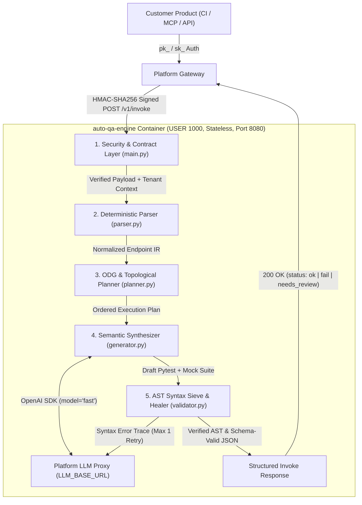
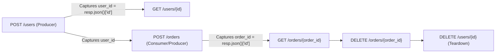

# AutoQA Engine — System Architecture (`architecture.md`)

**Contract Specification:** `spec_version: "1.1"` (November 2026)  
**Agent Slug:** `auto-qa-engine`  
**Supported Platform Integration Types:** `[ci, mcp, api]`  
**Primary Endpoint:** `POST /v1/invoke` | **Health Probe:** `GET /health`

---

## 1. Architectural Philosophy: "Planner-First, AI-Second"

Traditional LLM-based test generators feed raw OpenAPI/Swagger specifications directly into a language model, resulting in:
- **Broken Syntax & Hallucinated Libraries:** Uncompilable Python code or non-existent `pytest` plugins.
- **State-Dependent 404 Failures:** Executing `GET /users/{id}` or `DELETE /users/{id}` before creating the resource via `POST /users`.
- **Weak Test Oracles:** Shallow assertions (e.g., `assert response.status_code == 200`) that ignore response JSON schemas, field types, and business constraints.

`auto-qa-engine` eliminates these failure modes by enforcing a strict **4-Stage Hybrid Pipeline** where deterministic static analysis and graph theory handle structural orchestration, and the platform LLM proxy (`fast` alias) is strictly scoped to semantic payload synthesis and single-turn AST repair.

---

## 2. End-to-End Data Pipeline & Hybrid Execution Flow



### Component Responsibilities

| Module | File Path | Deterministic vs. AI | Core Responsibility |
| :--- | :--- | :--- | :--- |
| **Gateway & Router** | `src/main.py` | Deterministic | Constant-time HMAC verification (`X-Platform-Signature`), 300s replay window check, SSRF guard, operation dispatch (`generate_tests`, `generate_mocks`, `analyze_coverage`), and schema-compliant error formatting. |
| **Spec Parser** | `src/parser.py` | 100% Deterministic | Parses OpenAPI v3.x (JSON/YAML) and route definitions. Resolves local `$ref` pointers, extracts paths, HTTP methods, path/query/header parameters, request bodies, and response JSON schemas into an Intermediate Representation (IR). |
| **ODG Planner** | `src/planner.py` | 100% Deterministic | Builds a Directed Acyclic Graph (DAG) of operations based on resource lifecycle and producer-consumer parameter bindings. Outputs topologically sorted execution chains. |
| **Semantic Synthesizer** | `src/generator.py` | Hybrid (Template + `fast` LLM) | Uses deterministic code templates for test scaffolding and invokes the platform LLM (`fast`) solely to synthesize realistic domain mocks, boundary values, type mutations, and OWASP API security/injection payloads. |
| **AST Sieve & Healer** | `src/validator.py` | Deterministic + Single-Turn AI Repair | Validates generated Python test files via `ast.parse()` and checks security constraints (no hardcoded secrets, no forbidden imports). Performs a single-turn self-healing repair call if syntax validation fails. |

---

## 3. Operation Dependency Graph (ODG) Design (`planner.py`)

To prevent stateful 404/409 errors during integration test runs, `planner.py` constructs an **Operation Dependency Graph** $G = (V, E)$ where:
- $V$ is the set of parsed API operations $O_i = (\text{method}, \text{path}, \text{req\_schema}, \text{resp\_schema})$.
- A directed edge $e = (O_p \to O_c) \in E$ exists if operation $O_p$ (**Producer**) outputs a resource identifier or state required as an input parameter by operation $O_c$ (**Consumer**).

### 3.1 Dependency Resolution Heuristics
1. **Resource Hierarchy Matching:** Base collection path `/resources` (`POST`) produces entities consumed by itemized path `/resources/{id}` (`GET`, `PUT`, `PATCH`, `DELETE`).
2. **Schema Property Binding:** Output property `id`, `uuid`, or `{resource}_id` in $O_p$'s `200`/`201` response schema maps to path parameter `{id}` or foreign key body field `{resource}_id` in $O_c$.
3. **CRUD Lifecycle Ordering:** Within the same resource group, operations are prioritized in topological order:
   $$\text{POST (Create)} \longrightarrow \text{GET (Read/Verify)} \longrightarrow \text{PUT/PATCH (Update)} \longrightarrow \text{DELETE (Teardown)}$$
4. **Cycle Breaking:** If circular references exist in complex specs, Tarjan's strongly connected components (SCC) algorithm breaks cycles by prioritizing `POST` endpoints with the fewest required foreign parameters.



---

## 4. AST Syntax Sieve & Self-Healing Loop (`validator.py`)

All generated Pytest suites must be guaranteed runnable before leaving the container:

1. **Markdown & Fence Stripping:** Extract pure Python source code if the LLM wraps payloads or code snippets in markdown blocks.
2. **Primary Parse (`ast.parse`):** Compile the source string into a Python Abstract Syntax Tree.
3. **Static Security Audit on AST:** Walk the AST nodes (`ast.walk`) to verify:
   - No forbidden system calls (`os.system`, `subprocess`, `eval`, `exec`).
   - Strict adherence to `pytest` and `httpx`/`requests` patterns.
   - Presence of meaningful `assert` statements per test function (rejecting empty tests or `assert True`).
4. **Single-Turn Self-Healing:**
   - If `SyntaxError` or `IndentationError` is raised, capture `(lineno, offset, text, msg)`.
   - Send a strictly bounded repair prompt to `LLM_BASE_URL` (`model="fast"`) containing the broken snippet and exact compiler traceback.
   - Re-verify with `ast.parse()`.
   - **Fallback Guarantee:** If the second AST check fails or the LLM proxy times out, `validator.py` falls back to a deterministic, 100% syntactically valid parameterized Pytest template compiled directly from the Parser IR and ODG plan, ensuring `output_schema` compliance at all times.

---

## 5. `POST /v1/invoke` Request & Response Schemas

`auto-qa-engine` implements `POST /v1/invoke` serving `[ci, mcp, api]` triggers.

### 5.1 Supported Operations
1. **`generate_tests`**: Full pipeline execution (Parse -> ODG Plan -> Positive/Negative/Security Test Synthesis -> AST Validation) returning runnable Pytest code, ODG execution order, and coverage metrics.
2. **`generate_mocks`**: Synthesizes realistic, schema-compliant positive and boundary/negative mock datasets for specified OpenAPI schemas.
3. **`analyze_coverage`**: Audits an OpenAPI spec (and optional existing test code) to identify untested routes, missing status code assertions, and security gaps (returning `status: "fail"` in CI mode if coverage falls below `min_coverage_threshold`).

### 5.2 Gateway Request Envelope (`POST /v1/invoke`)

**Headers:**
```http
POST /v1/invoke HTTP/1.1
Host: localhost:8080
Content-Type: application/json
X-Platform-Timestamp: 1767700000
X-Platform-Signature: 3f9a8b2c...e1
X-Tenant-Id: ten_42
X-Request-Id: req_8c1f9a02
```

**Body (`operation: "generate_tests"`):**
```json
{
  "operation": "generate_tests",
  "input": {
    "openapi_spec": "{\"openapi\": \"3.0.3\", \"info\": {\"title\": \"Users API\", \"version\": \"1.0.0\"}, \"paths\": {\"/users\": {\"post\": {...}}, \"/users/{id}\": {\"get\": {...}}}}",
    "base_url": "https://api.example.com",
    "include_negative_tests": true,
    "include_security_tests": true,
    "target_endpoints": ["/users", "/users/{id}"]
  },
  "config": {
    "test_framework": "pytest-httpx",
    "default_locale": "tr-TR",
    "fail_on_missing_auth": false,
    "min_coverage_pct": 80
  },
  "trigger": {
    "kind": "ci"
  }
}
```

### 5.3 Agent Response Envelope (`200 OK`)

```json
{
  "output": {
    "summary": {
      "total_endpoints": 2,
      "total_operations": 3,
      "generated_test_count": 9,
      "positive_tests": 3,
      "negative_boundary_tests": 4,
      "security_injection_tests": 2,
      "ast_valid": true,
      "self_healed": false,
      "estimated_coverage_pct": 100.0
    },
    "odg_plan": [
      {
        "step": 1,
        "operation_id": "create_user",
        "method": "POST",
        "path": "/users",
        "produces": ["user_id"],
        "consumes": []
      },
      {
        "step": 2,
        "operation_id": "get_user_by_id",
        "method": "GET",
        "path": "/users/{id}",
        "produces": [],
        "consumes": ["user_id"]
      }
    ],
    "pytest_code": "import pytest\nimport httpx\n...",
    "mock_datasets": {
      "create_user": {
        "valid_payload": {"name": "Ayşe Yılmaz", "email": "ayse.yilmaz@example.com", "age": 29},
        "boundary_payloads": [
          {"name": "", "email": "invalid-email", "age": -1}
        ],
        "security_payloads": [
          {"name": "'; DROP TABLE users; --", "email": "admin@example.com' OR '1'='1", "age": 999999}
        ]
      }
    }
  },
  "status": "ok",
  "artifacts": [
    {
      "name": "test_generated_api.py",
      "mime_type": "text/x-python",
      "content": "import pytest\nimport httpx\n..."
    }
  ],
  "actions": []
}
```

### 5.4 Standard Error Response Envelope (`4xx` / `5xx`)

- **HTTP 401 Unauthorized:** Missing/invalid `X-Platform-Signature` or expired `X-Platform-Timestamp` (> 300s).
- **HTTP 422 Unprocessable Entity:** Unknown `operation`, malformed OpenAPI specification, empty routes, or blocked SSRF URL in input.

```json
{
  "error": {
    "code": "invalid_openapi_spec",
    "message": "Girdi olarak verilen OpenAPI şeması ayrıştırılamadı: 'paths' alanı eksik veya boş."
  }
}
```
